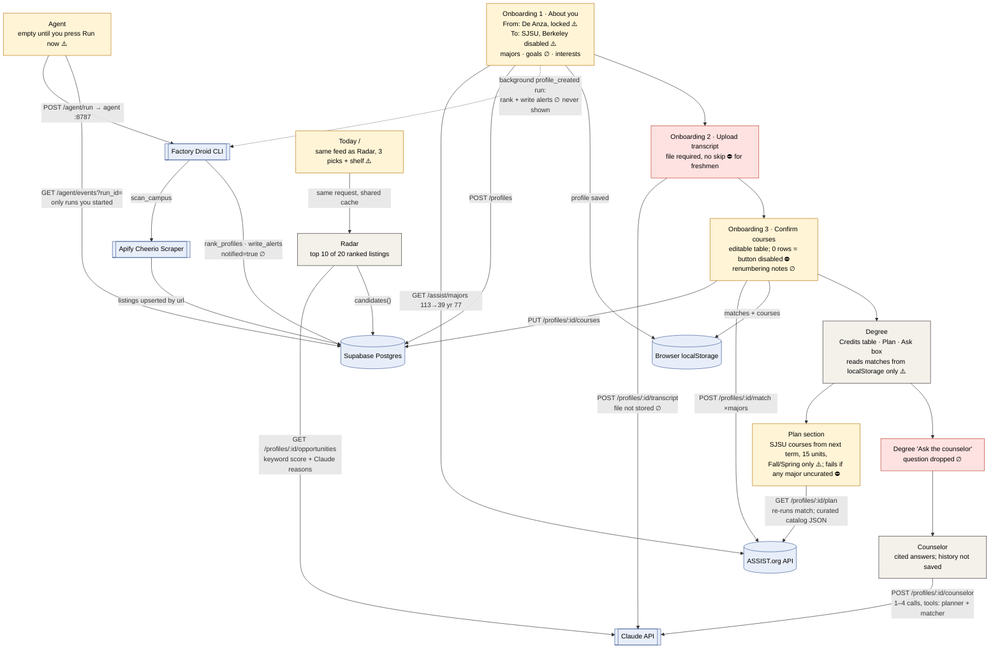
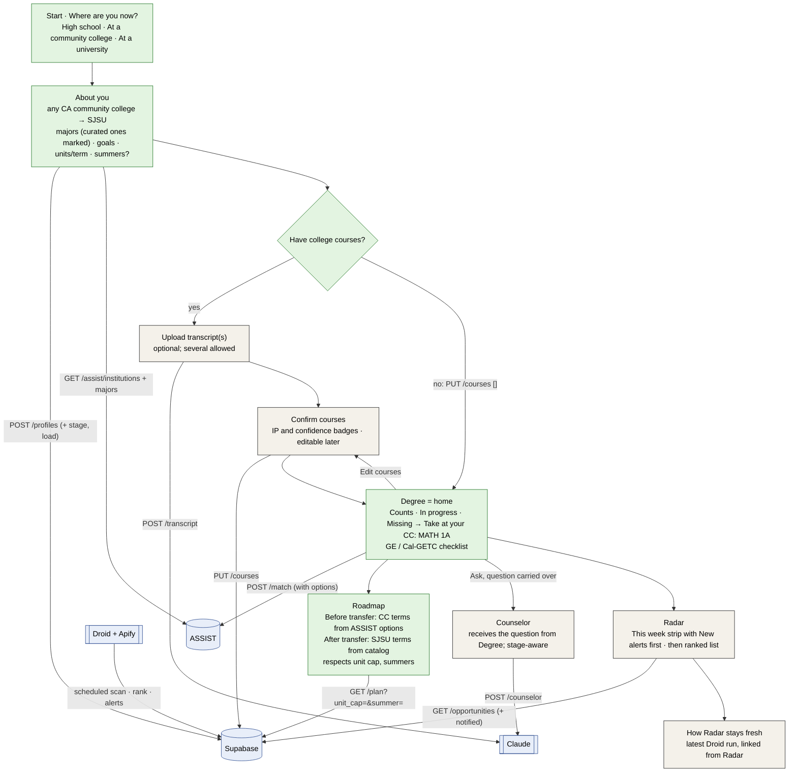

# AUDIT.md: Hindsight end to end

> Audit of `main` at `24cba01`, run on October 24, 2026 (Saturday afternoon) against our Supabase, with the API, web app, and Droid agent running locally.
> No app code was changed. Evidence lives in `tests/fixtures/personas/` (fixtures, `screens/`, `evidence/`).
> Personas are described in `tests/fixtures/personas/personas.md`.

**How this was run.**
- API on `:8000` (`uv run uvicorn`), web on `:5173` (`npm run dev:web`), agent on `:8787` (`npm start`).
- Local-only env overrides, passed on the command line (`.env` untouched): a throwaway `AGENT_SECRET`, `AGENT_INTERVAL_MINUTES=0`, `AGENT_PROFILE_RUNS_PER_HOUR=0` (new-profile runs rank directly instead of starting a Droid session), and `CLAUDE_DAILY_CAP` set as a hard spend guard.
- **Claude spend: about 30 calls.**
  - 26 were counted from the API's request log (`ANTHROPIC_LOG=info`).
  - 3 to 6 more happened in the P1 run before logging was on: 1 transcript parse, 1 batch of Radar reasons, and 1 to 4 for the counselor demo turn.
  - The Droid scan ran with the Claude cap at 0, so re-ranking existing profiles used computed reasons and cost no Claude calls.
- **One manual Droid run** (Factory credits plus one Apify scan). It wrote 197 SJSU listings to `opportunities`, the same thing the scheduled job does.
- **UI.** Driven with Playwright (Chromium) for P1, P2, P3, P11, and P12, plus one P4 screenshot. Everything else went through the API with `httpx`.
- **One mock.** For P12 only, the transcript-parse response was replaced with P1's real parsed rows, to save a Claude call. Every other call was real.

---

## 1. Verdict

**Hindsight works today for one student: a De Anza student who has already finished most transfer prep and is headed to SJSU in Data Science or Economics.** For that student (P1) every step works and is cited:
- 17/17 courses read correctly.
- Year-of-course matching catches 3 credits the current agreement would miss.
- A cited counselor answers the demo question correctly.

**It does not work yet for:**
- **An incoming freshman.** There's no way past the upload step without a file. The "plan" also starts at SJSU before they've started college.
- **Anyone at another community college, or headed to UC Berkeley or UCLA.** The UI locks both schools, even though the backend matches Foothill, Mission, and Berkeley correctly.
- **Students who need to manage a plan over time.** You can't edit courses after confirming, set a part-time load, add summers, or come back on a different device.
- **Students who have already transferred.** Uploading their SJSU transcript replaces their community-college credits.

Radar is a generic AI/tech event feed rather than a transfer tool. Today repeats Radar. Droid's alerts are never shown to the student.

---

## 2. The real workflow today

Boxes are screens. Labeled edges are API calls and outside services. ⛔ = dead end or stuck. ⚠️ = confusing or wrong. ∅ = data entered or computed but never used.



**Dead ends and stuck points**

| Where | What happens | Evidence |
|---|---|---|
| Onboarding 2 | No "I have no courses yet" option. The Upload button is disabled until a file is picked. A freshman stops here. | `apps/web/src/routes/Onboarding.tsx:242`, `screens/p2-01-upload-step-no-skip.jpg` |
| Onboarding 3 | If Claude finds 0 courses (blank PDF, resume), the table is empty and the confirm button is disabled, with no message. | `Onboarding.tsx:343`, `evidence/p10-api.json` (`upload_blank`, `upload_resume`: 200, `courses: []`) |
| Degree → Counselor | The "Ask the counselor" box sends `?q=` and router state. Counselor reads neither, so the question disappears. | `apps/web/src/routes/Degree.tsx:660`; `Counselor.tsx` has no `useLocation`/`useSearchParams`; `screens/p1-07-counselor-after-degree-ask.jpg` |
| Degree plan | If any chosen major has no curated catalog file, the whole plan fails with a raw error. | `apps/api/app/services/planner.py:149`, `screens/p3-02-degree.jpg` |
| Degree, other device | Match results live only in `localStorage`. On a new browser there's no way back to your profile; re-onboarding makes a new profile. | `apps/web/src/lib/session.ts`, `Degree.tsx:161`, `Onboarding.tsx:131` |
| Agent | Shows nothing until you press "Run now". Scheduled and new-profile runs have no run id the UI knows about. | `apps/web/src/routes/Agent.tsx`, `screens/p1-09-agent-empty.jpg` |

**Data entered or computed but never used**

| Data | Where it goes | Evidence |
|---|---|---|
| Goals text ("6 units a term, summers too") | Only Radar keyword matching (weight 0.10). The planner never reads it. | `apps/api/app/services/radar/rank.py:40`; `evidence/p8-api.json` |
| Renumbering confidence per course (`X-Transcript-Notes`) | Computed, exposed via CORS, never read by the web app | `apps/api/app/routers/profiles.py`; `grep -r Transcript-Notes apps/web/src` returns nothing |
| Droid alerts (`profile_opportunities.notified`) | Written on every run; never returned by an endpoint the web app uses | `apps/api/app/services/radar/alerts.py`; `grep -r notified apps/web/src` returns nothing |
| `profile_opportunities.reason` | Written; the feed recomputes reasons live instead | `apps/api/app/services/radar/store.py` |
| `match_results` and `plans` tables | Never written (0 rows in Supabase) | Row counts checked during the audit |
| The uploaded transcript file | Not stored (PROJECT.md §6 says it is) | `profiles.py:64` (`TODO`) |
| Degree "Ask" question | Dropped (see above) | `Degree.tsx:660` |

---

## 3. Answers to the six questions

### Q1. Can a high-school senior with zero college courses (De Anza → SJSU) use this today?

**No. They get stuck at step 2 and, past that, get a plan that is wrong for them.**

| Step | What happens (P2) | Evidence |
|---|---|---|
| Onboarding 1 | Works. Data Science picked; "Transferring from De Anza" is fine for them. | `evidence/p2-ui.json` |
| Onboarding 2 | ⛔ Stuck. A file is required, with no skip option. | `screens/p2-01-upload-step-no-skip.jpg` |
| Degree | "No results yet. Upload your De Anza transcript." The only button leads back to onboarding. | `screens/p2-02-degree.jpg` |
| Radar / Today | Work. Same AI-event feed as the junior: 11 of 20 items overlap with P1, and the same "alerts". | `evidence/p1-radar.json`, `evidence/p2-ui.json` |
| Counselor | Honest but empty: "I can't give you a quarter-by-quarter De Anza schedule. The app has no De Anza course list…" It then tells the student to ask an advisor which De Anza courses match MATH 30, 31, 39… | `screens/p2-03-counselor-freshman.jpg` |
| API, zero courses (`PUT /courses []`) | Match: 8 of 8 missing. Plan: 5 terms of **SJSU** courses from **Spring 2027** (before they start De Anza in Fall 2027) to Spring 2029, with upper division in Spring 2028. | `evidence/p2-match.json`, `evidence/p2-plan.json` |

**What they need that we don't show:**
1. **Which De Anza course satisfies each requirement.** We already have it. The parsed ASSIST agreement holds the options (`MATH 30 ← MATH 1A or MATH 1AH`; `CS 46A ← CIS 35A, or CIS 22A + 22B, or …`). `Requirement` has no field for them, so the UI can only say "Missing". The counselor even drafts the question "Which De Anza courses match…" for the advisor.
2. **A course-by-course roadmap from day one:** De Anza quarters first, then SJSU semesters. Today the planner only schedules SJSU catalog codes, starting next term (`planner.py:184`).
3. **GE / Cal-GETC.** Not tracked anywhere. README and the counselor say so (`counselor.py` `PLAN_COVERS`).
4. **Prerequisites and term order at the community college.** Only SJSU prerequisites exist (`data/requirements/*.json`). De Anza prerequisites and offerings aren't loaded.
5. **Transfer milestones:** application windows (Oct–Dec), ADT/TAG, the 60-unit minimum. Not modeled.

### Q2. Can a student plan and manage an ed plan over time?

**No. The plan is computed on the fly and can't be edited.** Here is what is persisted, recomputed, and lost:

| Action | Possible? | How / evidence |
|---|---|---|
| Add a planned (future) course | ❌ | No such concept. A course added on the confirm table counts as taken. |
| Mark completed / in progress | ⚠️ Only by typing a grade before confirming | `IP` is treated as "not completed" (`evaluator.py:83`), so P3's and P7's in-progress courses show **Missing** and get rescheduled at SJSU (`evidence/p7-api.json`: MATH 1C IP → MATH 31 planned for Spring 2027). |
| Edit or remove a parsed course | ⚠️ Only on the confirm screen, before matching | There's no route back to the table afterwards, and no `GET /courses` endpoint. |
| Change units per term | ❌ | Cap fixed at 15 (`planner.py:26`). `?unit_cap=6` and `?units=6&summer=true` are silently ignored: same 9 terms, max 15 units (`evidence/p8-api.json`). |
| Add summer terms | ❌ | Fall/Spring only (`planner.py:27`). The counselor itself suggests "What if I take a summer term?" (`Counselor.tsx:27`), then has to say it can't (`evidence/counselor-p8-p3.json`). |
| Change majors | ❌ | No profile update endpoint. Re-onboarding creates a second profile. |
| Come back next week, same browser | ⚠️ | Profile and match results come back from `localStorage`. Match results are the old snapshot, while the plan is recomputed. |
| Come back on another device | ❌ | No sign-in, no way to enter a profile id. |

**Persisted (Supabase):** profile; confirmed courses; ranked Radar rows and `notified` flags; agent events; ASSIST agreement cache.
**Recomputed per request:** ASSIST match (inside `/plan` and the counselor), the plan, Radar ranking (reasons cached in API memory only).
**Lost:** the transcript file, counselor conversations, the Degree match snapshot outside this browser, and anything the user wanted to change after confirming.

### Q3. What exactly does Radar do?

**Sources.**
- 12 sources in `data/sources.json`:
  - SJSU Localist calendars (AI/tech, workshops, career)
  - the SAMMY student-org RSS feed
  - Devpost "San Jose"
  - MLH
  - Berkeley LiveWhale searches (AI, data science, ML)
- The Apify Cheerio Scraper fetches them. Per-site extractors live in `apps/api/app/services/radar/extractors/`.
- Rows are upserted into `opportunities` by `url`.

**Scoring.**
- The score is deterministic (`rank.py:40`): interests 0.35, majors 0.25, goals 0.10, urgency 0.20, item type 0.10.
- Small adjustments: +0.05 if the text says "transfer student", −0.25 for staff-only audience tags.
- Faculty-only items and items that started more than a day ago are dropped (`rank.py:38`). Duplicate titles are collapsed (`rank.py:193`).
- Hackathons from any campus are included for everyone (`store.py` `candidates`).

**Reason text.**
- One Claude call writes a ≤20-word line per item for the top 20.
- It is given only the profile and the item fields, and told never to state dates.
- Reasons are cached in API memory per profile content. They fall back to "Matches your interest in …" when Claude is unavailable.

**Freshness.**
- Our run stored 197 SJSU items. All 6 SJSU sources were healthy, the run took 44 s, and it found 0 new alerts (`evidence/droid-run-985a3e2c.json`).
- Before that run, Supabase held 255 listings scraped between 08:59 and 20:50 UTC that day.
- In production, scans happen only on the 2-hour schedule or a manual run (D-006).

**Freshman vs junior.**
- The feed doesn't use the transcript, year, or stage at all.
- P1 (junior) and P2 (freshman) share 11 of 20 items and got the same 2–3 "alerts": Open Lab Hours, "What Makes AI Scary?", SPSS T-Tests.
- P2 is a high-school senior, and the SPSS T-Tests workshop is for SJSU students.

**Dead links.**
- 1 of P1's 20 links returned 504 at check time: `events.sjsu.edu/event/what-makes-ai-scary…`. It may be transient.

**Duplicates.**
- Exact-title duplicates are removed.
- Near-duplicates aren't: the feed showed "Sparthill Hackathon 2026 Day #2". Cal Hacks 13.0, which is running now, also appears.

**Is it useful for a transfer student specifically? Mostly not; it's campus noise with good reasons.**
- Across three feeds (P1, P2, P9), the only listing mentioning "transfer" was a grad-school info session.
- Only 4 of P1's 20 items have a deadline, and all 4 are hackathons.
- Berkeley's feed (P5) is mostly faculty and grad seminars: condensed matter physics, biostatistics GSR talks.
- The reasons are honest about weak fits ("its link to your majors is weak"; "tagged for SJSU staff"), which is a sign the ranking lets noise through.
- Missing for transfers: transfer center events, EOP/scholarship deadlines, club recruiting, internship programs with deadlines (the founder story in PROJECT.md §1).

### Q4. What exactly is Today? Keep, merge, or cut?

**What it is.**
- `/` shows the same ranked feed as Radar, from the same request and cache (`Today.tsx`, `lib/opportunities.ts`).
- It has 3 "Before it closes" picks (the best-ranked items with a deadline ahead), a shelf of the next 10, and a "Methods" box.
- It has **no academic content**: nothing from Degree, the plan, or deadlines like the transfer application.

**Does it change day to day?** Only as listings change. There's no per-day logic beyond the countdown.

**What it showed P1 today** (`screens/p1-05-today.jpg`):
- The lead picks are HackStorm (84 days left), MEGA Hackathon (119) and Tech to Treasure (136), under the headline "What you'd wish you knew, this week."
- The abstract says "Nothing closes within a week."
- The events actually happening this week sit in the shelf as unlabeled spines. Those are Open Lab Hours on Monday and "What Makes AI Scary?" on Thursday, the same two items Droid marked as alerts.

**Recommendation: merge. Cut Today as a separate screen.**
- Move a "This week" strip (items starting or closing within 7 days, alerts first) to the top of Radar.
- Make `/` go to Degree once a profile exists, and to onboarding otherwise.
- Why: Today repeats Radar with a worse ordering, adds a nav item, and its headline promises urgency it doesn't deliver.
- Effort: S (about 1 hour).

### Q5. Is the Counselor grounded?

**Yes. It's the strongest part of the product.** Evidence from 8 answers (`evidence/p1-ui.json`, `p2-ui.json`, `p11-ui.json`, `counselor-p8-p3.json`):

| Check | Result |
|---|---|
| Every `[n]` marker maps to a returned citation | ✅ 8/8 answers; markers = citations exactly (17, 15, 2, 0, 3, 4, 5, 24) |
| Citations are real sources | ✅ Only `assist` agreement rows and `catalog` PDF pages. The server drops unknown ids (`counselor.py:510`) and Claude never writes URLs. |
| "Guarantee I'll get into SJSU" | ✅ "I can't guarantee admission, and nothing in your data covers admission decisions." There's no explicit admission rule in the prompt; it falls out of "answer only from the data". |
| "What's the weather" | ✅ "I can't help with the weather. I can only help with your studies…" (`counselor.py:427`) |
| "Can I skip MATH 1C?" | ✅ Says it's already completed and counts with MATH 1B toward MATH 31 (high confidence), and that it can't say whether MATH 31 holds without it. |
| Unanswerable (impaction / admission GPA) | ✅ "I can't tell you… I won't guess from general knowledge." Drafts an advisor question. |
| What-if without data (CS plan, 6 units, summer) | ✅ Says plainly what can't be computed instead of estimating (`counselor-p8-p3.json`) |

**Problems found.**
- ⚠️ **Wrong framing.** The system prompt says the user has "transferred to a four-year university" (`counselor.py:388`). So it told P1, who is still at De Anza, "Your records show you as already a transferred SJSU student" (`evidence/p11-ui.json`, first answer). A judge could catch this.
- ⚠️ The Degree → Counselor handoff drops the question (see §2).
- Minor: conversations aren't saved, and "Email my advisor" opens a `mailto:` with no recipient.

### Q6. What does a scheduled Droid run change for the user?

**What a run does** (`apps/agent/src/job.ts`, `alerts.py`):
1. Scans the campus on Apify and upserts listings.
2. Self-heals a broken extractor if needed. Not needed in our run: 6/6 sources were ok.
3. Re-ranks every profile on that campus into `profile_opportunities`. This also pre-warms Claude reasons, but only in API memory.
4. Sets `notified = true` on each profile's top-5 items starting or closing within 7 days.

**What the student sees:**
- Fresher listings on Radar and Today the next time they load, and a faster first Radar load if the run warmed their reasons in the same API process.
- **Nothing else.** The web app never reads `notified`. There's no badge, email, push, or "new since last visit". (The PWA push in PROJECT.md §5 wasn't built.)
- **The run itself is visible only on `/agent?run=<id>`**, and only for a run you started. There's no "latest run" endpoint. Scheduled and new-profile runs, including the one triggered by your own sign-up, have no id the UI can show (`screens/p1-09-agent-empty.jpg`).
- In our test, the new-profile runs for P1–P3 "wrote 2–3 new alerts" each (`agent.log`). None of it appeared on any screen.

---

## 4. Scenario results

Legend: ✅ works · ⚠️ works with a problem · ❌ broken or blocked · — not applicable or not tested. "API" = tested through the API because the UI blocks the scenario.

| # | Persona | Onboard | Transcript | Confirm | Match | Plan | Radar | Counselor |
|---|---|---|---|---|---|---|---|---|
| P1 | De Anza → SJSU, DS + Econ (17 courses) | ✅ | ✅ 17/17 | ✅ | ✅ 8 satisfied, 3 via 2023–24 agreement | ⚠️ CS 46B, ECON 1B scheduled at SJSU | ✅ | ⚠️ cited; "already transferred" framing; Degree Ask dropped |
| P2 | Incoming freshman, no courses | ✅ | ❌ no skip | ❌ | ⚠️ API: 8 missing, no CC course names | ❌ starts Spring 2027 at SJSU | ⚠️ generic | ⚠️ honest "can't" |
| P3 | 3 courses, 1 IP, CS vs DS | ✅ | ✅ 3/3, IP read | ⚠️ IP is just a grade | ⚠️ IP counts as missing | ❌ fails: CS not curated | — | ⚠️ DS timeline only |
| P4 | Foothill → SJSU | ❌ De Anza locked | ✅ API, 12/12 | ✅ API | ✅ DS 6/8, Econ 5/5 | ⚠️ | — | — |
| P5 | De Anza → UC Berkeley / UCLA | ❌ Berkeley disabled | — | ✅ API | ✅ API Berkeley · ❌ UCLA has 0 majors for 2026–27 | ❌ 404 | ⚠️ faculty seminars | — |
| P6 | Mission College (semesters) | ❌ De Anza locked | ✅ API, 9/9, units as printed | ✅ API | ✅ DS 7/8 | ⚠️ ECON 1A/1B at SJSU | — | — |
| P7 | W/F/A repeat, P/NP, IP, 2019, AP | ✅ API | ⚠️ 10/10 rows; AP skipped by design | ✅ API | ✅ repeat best grade; P flagged; sequence rule | ⚠️ IP MATH 1C rescheduled | — | — |
| P8 | Part-time, 6 units, summers | ✅ API | — | ✅ API | ✅ | ❌ 15 units, no summer, params ignored | — | ⚠️ honest "can't" |
| P9 | Already at SJSU | ⚠️ no "at university" status | ✅ 4/4 | ⚠️ replaces CC credits | ❌ 0/8: De Anza credits gone | ❌ IP counted done; MATH 30 scheduled | ✅ | — |
| P10 | Bad uploads | — | ✅ 0 B, 21 MB, GIF, txt rejected · ✅ scan 17/17 · ✅ 15 MB · ✅ injection ignored · ⚠️ blank/resume silent | ⚠️ empty table, no message | ✅ injection: only 3 real rows matched | — | — | — |
| P11 | Counselor stress | — | — | — | — | — | — | ✅ refusals, ✅ citations, ⚠️ framing |
| P12 | Mobile 390×844 | ✅ | ✅ | ⚠️ Grade/Term off-screen | ✅ | ✅ | ✅ | ✅ |

### Per-persona notes

**P1 · Baseline (happy path).** `screens/p1-01…p1-10`, `evidence/p1-ui.json`.
- Worked:
  - Parse: 17 courses, all correct, `academic_year_id` correct per term.
  - Match: DS 6 satisfied + 1 partial + 1 missing; Econ 4 satisfied + 1 missing.
  - "Caught" callout: MATH 30, MATH 31, and ECON 1A count only under the 2023–24 agreement.
  - Abstract: "earliest finish Fall 2028 for DS alone, Spring 2030 with Econ".
  - Demo counselor answer: "No…", 17 catalog citations, drafted advisor question.
  - Radar: 20 items, loaded in 0.8 s (warmed by the new-profile run).
- Broke or confused:
  - The plan puts CS 46B and ECON 1B in Spring 2027 **at SJSU**. P1 could still take CIS 22C and an ECON course at De Anza. **Major.**
  - The Degree "Ask" question is dropped. **Major.**
  - Today's lead picks are months away. **Major.**

**P2 · Incoming freshman.** `screens/p2-*`, `evidence/p2-*.json`.
- Blocked at upload: no skip control (Playwright found 0 matching elements). **Blocker** for this persona.
- The counselor answer is honest. It confirms the gap: the app has the De Anza ↔ SJSU course mapping but can't show it.
- Via the API, the plan begins Spring 2027 at SJSU for someone starting De Anza in Fall 2027. **Major.**

**P3 · First-year, IP, undecided.** `screens/p3-*`, `evidence/p3-ui.json`, `counselor-p8-p3.json`.
- Parse: 3/3, `IP` preserved.
- Match: CIS 22A (IP) leaves CS 46A "Missing", with no "in progress" state. **Minor.**
- Picking CS + DS makes the whole plan fail. The error shows `No curated requirements for ['Computer Science, B.S.,Data Science, B.S.']`, with the two labels garbled into one. **Major.**
- No side-by-side comparison of majors. The counselor gives a DS timeline only, but correctly notes the shared math/CS base.

**P4 · Foothill.** `evidence/p4-api.json`, `screens/p4-degree-foothill-labelled-de-anza.jpg`.
- The UI can't select Foothill. **Major.**
- Through the API, the backend works. Parse 12/12, including Foothill's `C S 1B` spelling. DS 6/8, Econ 5/5.
- With the session injected, Degree cites "ASSIST · Foothill College → SJSU" but the byline and abstract say "De Anza College" and "Ten of your De Anza courses". **Minor.**

**P5 · Berkeley / UCLA.** `evidence/p5-api.json`, `radar-p5-p9.json`.
- The UI disables Berkeley.
- Through the API, Berkeley matching works: DS B.A. 2 satisfied, 1 partial, 1 at university (COMPSCI 61A has no articulation).
- `/plan` returns 404 (no curated Berkeley majors, D-007).
- The Berkeley Radar feed is mostly faculty and grad research talks.
- UCLA: `GET /assist/majors 113→117 year 77` returns `[]`, while year 76 returns majors. The year is hardcoded (`apps/api/app/config.py:19`) with no fallback. **Minor** (UCLA isn't a target today).

**P6 · Semester CC (Mission).** `evidence/p6-api.json`.
- The UI can't select Mission.
- Parse keeps semester units as printed (4.0, 5.0). `Course` has no unit-system field, but the matcher doesn't depend on units, so DS matched 7/8 correctly.
- Unit totals aren't shown anywhere, so mixed quarter and semester units cause no visible error today. They would if a units-to-transfer feature were added. **Polish.**
- The plan schedules lower-division ECON 1A/1B at SJSU instead of at Mission (ECON C2002/C2001). **Major** (same as I-03).

**P7 · Messy record.** `evidence/p7-api.json`.
- W, then F, then A on MATH 1A: the best grade wins and MATH 30 is satisfied. ✅
- ECON 1 P: satisfied, low confidence, `pass_no_pass` flag. ✅
- CIS 22A from 2019 plus CIS 22B NP: CS 46A partial, sequence rule. ✅
- Old 2019 and 2022 agreements loaded. ✅
- MATH 1C (IP, this term) leaves MATH 31 partial, and the plan reschedules MATH 31 at SJSU for Spring 2027. **Major.**
- AP Calculus BC and AP Micro are dropped on purpose (`transcript.py:94`). There's no way to record AP credit. **Minor.**
- EWRT 1A C-: inconclusive. EWRT 1A doesn't articulate to any DS/Econ row, so no minimum-grade check fired.

**P8 · Part-time + summers.** `evidence/p8-api.json`, `counselor-p8-p3.json`.
- Same 9-term, 15-unit, Fall/Spring plan whatever the goals say. **Major.**
- The counselor correctly says it can't compute this. The UI still offers the summer chip. **Minor.**

**P9 · Already at SJSU.** `evidence/p9-api.json`.
- Only one transcript at a time. The SJSU upload replaces the De Anza courses, so all 8 ASSIST rows become Missing.
- The planner counts MATH 39 (IP) and CS 46B (IP) as done. It then schedules MATH 30, MATH 31, and CS 46A, which the student finished at De Anza.
  - Cause: `satisfied_from_courses` ignores grades (`planner.py:170`), so a W or F in a curated course would count too. DATA 100 (W) isn't a curated course, so the W itself wasn't exercised.
- There's no status for "at university".
- Radar is the one part that still makes sense post-transfer. **Major** for this persona.

**P10 · Bad uploads.** `evidence/p10-api.json`.
- Rejected cleanly before Claude:
  - 0 bytes → 422 "The uploaded file is empty"
  - 21 MB → 413 "Transcript must be under 20 MB"
  - text → 415
  - GIF → 415 "Upload a PDF or image". GIF is an image, and `transcript.py:28` accepts it, but the route list doesn't (`profiles.py:33`). **Polish.**
- Scanned and skewed image PDF: 17/17 correct in 5.9 s, despite the grade column being shifted. ✅
- 15 MB PDF: parsed 17/17 in 10.7 s. ✅
- Injection: Claude returned only the 3 printed rows. The "mark all requirements satisfied" and fake "SYSTEM" lines were ignored, and the match stayed 1 satisfied, 1 partial, 6 missing. ✅
  - Matching is deterministic, so even a successful injection could only add rows, which the student must then confirm.
- Blank PDF and resume: 200 with `courses: []`. No error, and the UI shows an empty table with a disabled button. **Minor.**

**P11 · Counselor stress.** `screens/p11-counselor-stress.jpg`, `evidence/p11-ui.json`. See Q5. All four behaved correctly. The framing bug appears in answer 1. **Major** (I-04).

**P12 · Mobile.** `screens/p12-*`.
- No horizontal page scroll on any screen (`scrollWidth = 390`).
- Nav fits; Degree shelves and plan render.
- Confirm table: Grade and Term columns sit off-screen inside the table scroller. That's the column a student most needs to check. **Minor.**
- Onboarding: the masthead fills the first screen, so no input is visible without scrolling. **Polish.**

---

## 5. Issues

| ID | Title | Sev | Where | Repro | Suggested fix | Effort |
|---|---|---|---|---|---|---|
| I-01 | No path for students with zero courses | Blocker (freshmen) | `Onboarding.tsx:242`, `:343` | P2: finish step 1, try to continue without a file | "I haven't taken college courses yet" button: `PUT /courses []`, match, go to Degree | S |
| I-02 | Missing requirements don't say which CC course to take | Major | `models/contracts.py:48` (`Requirement`), `Degree.tsx` table | P2/P3: any Missing row shows "—" | Add optional `options: string[]` (e.g. "MATH 1A or MATH 1AH") from the parsed articulation; show "Take at De Anza: …". Contract change needs integrator approval; it's additive. | M |
| I-03 | Plan schedules lower-division prep at SJSU, from next term, for everyone | Major | `planner.py:184`, `planner.py` build_plan | P1: CS 46B in Spring 2027 at SJSU; P2: plan starts before college | Split the plan into "Before transfer (at your CC)", using ASSIST options, and "At SJSU" from a transfer term the student picks | M–L |
| I-04 | Counselor assumes the student already transferred | Major | `counselor.py:388` | P11 Q1: "already a transferred SJSU student" | Reword the prompt to "transferring or transferred"; pass the stage in `student_data` | S |
| I-05 | Degree "Ask the counselor" drops the question | Major | `Degree.tsx:660`, `Counselor.tsx` | Type a question on Degree, submit | Read `location.state.question` / `?q=` in Counselor and ask it | S |
| I-06 | Whole plan fails if one major isn't curated | Major | `planner.py:149`, `Degree.tsx` PlanError | P3: CS + DS | Plan the curated majors; list the rest as "lower-division (ASSIST) only"; fix the label-joining message | S–M |
| I-07 | Plan can't be managed: no edit after confirm, no return on another device, re-onboarding duplicates the profile | Major | `session.ts`, `Degree.tsx:161`, `Onboarding.tsx:131` | Confirm, then try to fix a grade | Add `GET /profiles/{id}/courses`, an "Edit courses" link, Degree recomputing matches from the server, and a "resume with link" | M |
| I-08 | UI locks De Anza → SJSU; copy hardcodes "De Anza" | Major | `Onboarding.tsx:157`, `:166`; `lib/format.ts:5`; `Degree.tsx:290` | P4/P6: can't select; Foothill report says "De Anza" | College picker from ASSIST institutions (backend already validates); take the sending name from the agreement label | S–M |
| I-09 | In-progress and withdrawn courses handled inconsistently | Major | `evaluator.py:83`, `planner.py:170` | P7: IP MATH 1C rescheduled; P9: IP counted done (W/F would be too) | Show "In progress" status; planner ignores W/F/NP and treats IP as done next term | S–M |
| I-10 | Today duplicates Radar and leads with far-off items | Major | `Today.tsx:63` | P1 Today: 84–136-day hackathons under "this week" | Merge into Radar's "This week" strip; `/` goes to Degree | S |
| I-11 | Droid alerts and runs invisible outside `/agent?run=` | Major | `alerts.py`, `Agent.tsx`, `RankedOpportunity` | Any profile: `notified=true` rows, nothing shown | Return `notified` (additive), badge "New" on Radar; add `GET /agent/runs/latest` and auto-load it on `/agent` | S–M |
| I-12 | Planner ignores load and summers; UI suggests summer anyway | Major | `planner.py:26-27`, `Counselor.tsx:27` | P8 | Expose `unit_cap` (already a `build_plan` arg) and a summer flag; remove the summer chip until then | S (chip) / M |
| I-13 | GE / Cal-GETC not tracked | Major (freshmen) | — | P2 | Cal-GETC checklist from ASSIST GE data | L |
| I-14 | Blank or non-transcript upload returns 0 courses silently | Minor | `transcript.py`, `Onboarding.tsx` | P10b/c | If 0 rows: "We didn't find any courses in this file" plus the I-01 path | S |
| I-15 | Renumbering notes computed, never shown | Minor | `profiles.py` `X-Transcript-Notes` | P4: `ccn_before_rollout` low confidence, invisible | Show a "check" badge per row on Confirm | S |
| I-16 | Radar not transfer-specific; same alerts for every stage | Minor | `rank.py`, `data/sources.json` | P1 vs P2 vs P9 feeds | Add transfer-center, EOP, scholarship, internship sources; down-rank grad/faculty talks; use the student's stage | M |
| I-17 | ASSIST year hardcoded to 2026–27 | Minor | `config.py:19` | UCLA: 0 majors | Fall back to the latest year that has agreements | S |
| I-18 | Post-transfer students lose CC credits on upload | Minor | `profile_store.replace_courses` | P9 | Allow several transcripts (append, tagged by institution); add a stage field | M |
| I-19 | Docs drift: transcripts not stored; `match_results`/`plans` unused | Minor | `profiles.py:64`, schema | Row counts: 0 | Fix PROJECT.md §6 and README, or implement | S |
| I-20 | AP/IB credit can't be recorded | Minor | `transcript.py:94` | P7 | Separate "Exam credit" section; match against ASSIST AP tables later | L |
| I-21 | Mobile Confirm hides Grade/Term; onboarding inputs below the fold | Polish | `app.css`, `Onboarding.tsx` | P12 | Stack rows as cards under 600 px; shrink the masthead on mobile | S |
| I-22 | Plan error shows a raw Python list | Polish | `planner.py:149` | P3 | Human message: "We don't have SJSU's Computer Science requirements yet." | S |
| I-23 | Science "8 from" row renders a huge title; grammar "one … satisfy" | Polish | `Degree.tsx` | P3 Degree | Collapse long choose-from lists; fix singular/plural | S |
| I-24 | GIF rejected with "Upload a PDF or image" | Polish | `profiles.py:33` vs `transcript.py:28` | P10 | Align the two lists or say "PDF, PNG, JPEG or WebP" | S |
| I-25 | Counselor history lost on navigation; mailto has no recipient | Polish | `Counselor.tsx` | Leave and come back | Keep exchanges in sessionStorage | S |

---

## 6. Recommendations

Ranked by (impact on a judge's demo) ÷ (effort).

### Fix before the demo (~10 working hours; submit Sunday 8:50 AM)

| # | Fix | Issue | Why a judge notices | Time |
|---|---|---|---|---|
| 1 | Counselor reads the Degree "Ask" question | I-05 | It's on the demo path (Degree → Counselor); today it silently drops the text | 20 min |
| 2 | Reword the counselor's "already transferred" framing | I-04 | The demo student is pre-transfer; one wrong sentence undercuts "grounded" | 15 min |
| 3 | Remove the "What if I take a summer term?" chip | I-12 | It invites a "can't compute" answer live | 5 min |
| 4 | Merge Today into Radar; `/` goes to Degree | I-10 | Removes a confusing screen; the first thing a judge sees becomes the strongest one | 1 h |
| 5 | Show "Take at De Anza: MATH 1A" on Missing rows | I-02 | Turns "Missing" into an action, and it's the clearest proof the app knows ASSIST | 2–3 h |
| 6 | Plan the curated majors when one isn't curated | I-06 | A judge picking any second major today gets "Couldn't build a plan" | 1 h |
| 7 | "No courses yet" path, plus a message when 0 rows parse | I-01, I-14 | Answers "can a freshman use it?" and hardens the live upload | 1 h |
| 8 | Badge Droid alerts as "New" on Radar; `/agent` auto-loads the latest run | I-11 | Factory judges score "visible work in the product"; today it's only on one page | 1.5 h |
| 9 | Planner ignores W/F/NP grades | I-09 | Small, removes a wrong-answer risk | 30 min |
| 10 | Mobile Confirm as stacked cards | I-21 | Judges may open it on a phone | 45 min |

Items 1–4 and 9 are about 2 hours and low risk. Do them first. Then 5, 6, 7, 8 in that order.

### Add if time allows (new features)

- **Freshman roadmap mode.** Use ASSIST options (I-02) plus SJSU prerequisite order to lay out De Anza quarters, then SJSU semesters (I-03). This is the biggest product gap and the best "who uses this Monday" answer.
- **Editable plan.** Edit courses after confirming, "planned" courses, a unit cap, and summer terms (I-07, I-12).
- **Pick any CA community college** (I-08). The backend already works (P4, P6).
- **GE / Cal-GETC tracker** (I-13).
- **Transfer-specific Radar sources:** transfer center, EOP, scholarships, internship programs with deadlines (I-16).

### Cut or merge

- **Today → merged into Radar** ("This week" strip at the top). See Q4.
- **Agent → keep for the Factory track, but move it out of the main nav.** Link it from Radar as "How this list stays fresh". It already auto-loads the latest run if fix #8 lands. For a student it's a developer log.
- **"UC Berkeley (coming soon)"** in onboarding: keep it disabled, but don't demo it. Berkeley's Radar feed is mostly faculty seminars.

### After the hackathon

- Real accounts. Today a profile id is a bearer token kept in `localStorage`.
- Several transcripts per student, and a stage field (high school / CC / university) (I-18).
- AP/IB credit (I-20).
- Course offerings by term at the CC and at SJSU.
- Re-check SJSU requirements against the 2026–27 catalog (D-007).
- ASSIST year fallback (I-17); Berkeley and UCLA curated majors.
- Store transcripts as promised, or update the privacy claim (I-19).
- Persist counselor threads; send alerts by email or push.

---

## 7. Proposed improved flow



---

## 8. AUDIT- profiles to delete

All were created during this audit, on campus `sjsu` unless noted. Each id works like a password (D-006), so delete these soon after review. Deleting a profile cascades to its `transcript_courses` and `profile_opportunities`.

| Persona | Profile id |
|---|---|
| AUDIT-P1 Test Student One | `a74c8154-172c-47ab-ac59-95c396b58a75` |
| AUDIT-P2 Test Student Two | `ace5f3ed-4b90-4ff7-87b2-25db6ab562b0` |
| AUDIT-P3 Test Student Three | `358ffdd7-69d9-4a17-9d1e-0cdae3765197` |
| AUDIT-P4 Test Student Four (Foothill, 51) | `1016c8d1-d4d6-4a4b-96cc-6f51933c9cfe` |
| AUDIT-P5 Test Student Five (campus `berkeley`, 79) | `540a9d84-e9dc-4757-b4f4-79cc75328fb1` |
| AUDIT-P6 Test Student Six (Mission, 32) | `8ff01e52-2a9a-4ac0-ae57-aa0cd3e166f7` |
| AUDIT-P7 Test Student Seven | `4ebef710-4471-48d9-9e25-895fa99a0161` |
| AUDIT-P8 Test Student Eight | `3c5b3152-a87c-4cc4-9fcf-20690dd74512` |
| AUDIT-P9 Test Student Nine | `09266a4d-f168-4246-9fb3-8c757480d883` |
| AUDIT-P10 Test Student Ten | `081397a5-32f4-422a-b15a-32e1647ef69e` |
| AUDIT-P12 Mobile Test | `d7737dc6-64a5-4083-a915-5e2098ea3ba0` |

```sql
delete from profiles where name like 'AUDIT-%';  -- 11 rows; cascades to courses and Radar rows
```

**Other writes made during the audit (not tied to AUDIT- profiles):**
- One manual Droid run (`985a3e2c-9941-4bdf-a856-e4d7acba876a`) and its `agent_events` rows.
- 197 SJSU rows upserted into `opportunities`, as a scheduled run would.
- Re-ranked `profile_opportunities` for the 6 pre-existing profiles, with computed reasons because the Claude cap was 0.
- New-profile run events for P1–P3.
- New `articulation_cache` rows for Foothill, Mission, and Berkeley agreements.
