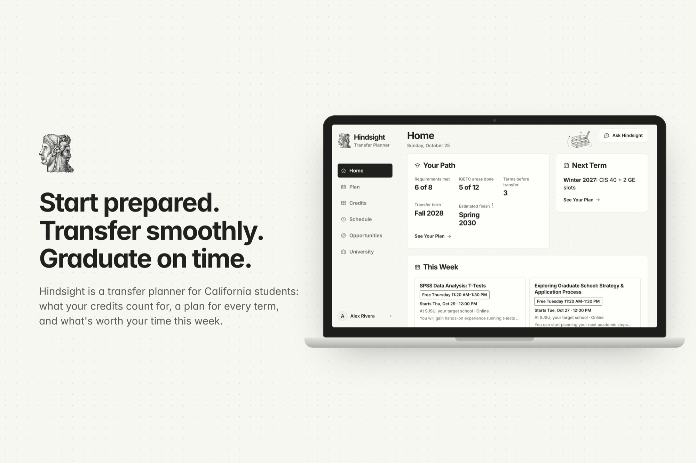
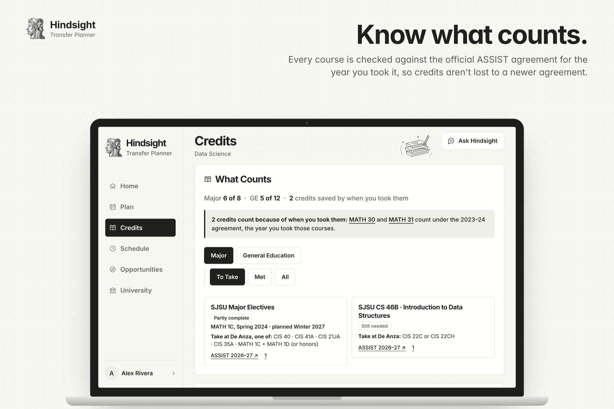
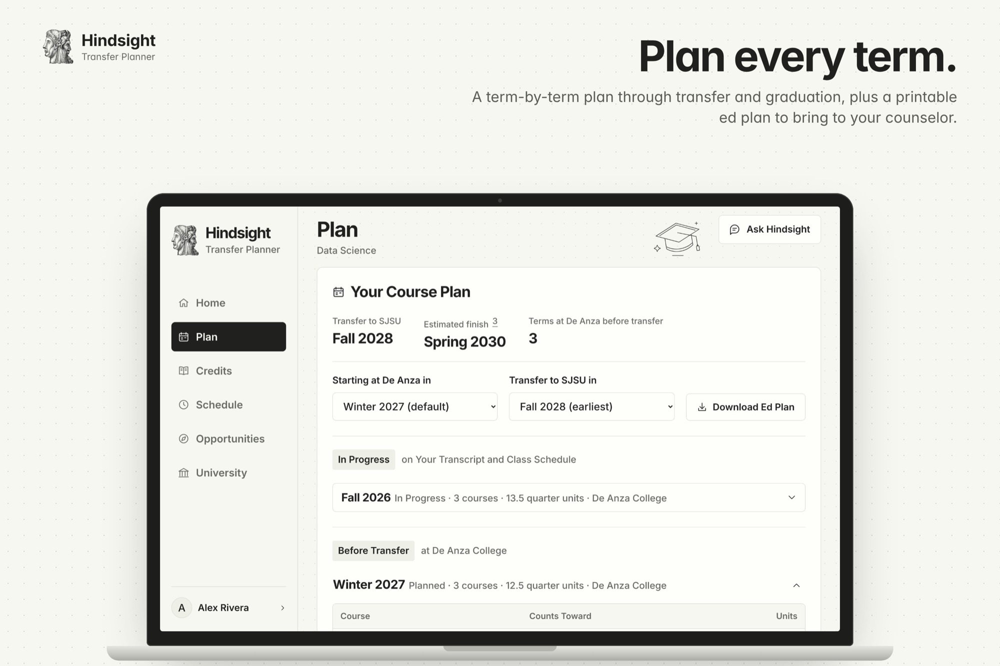
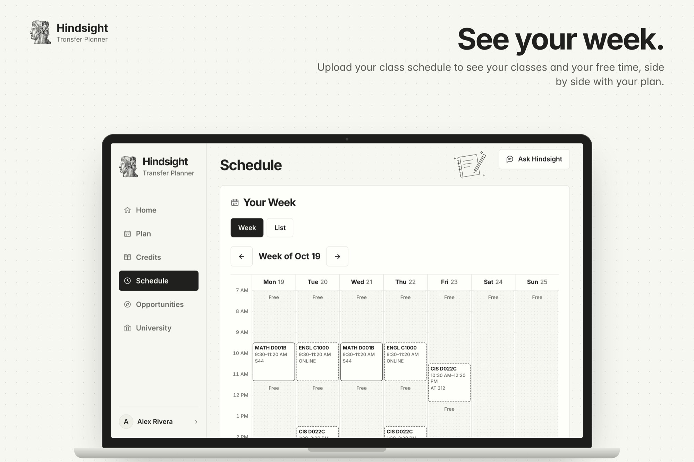
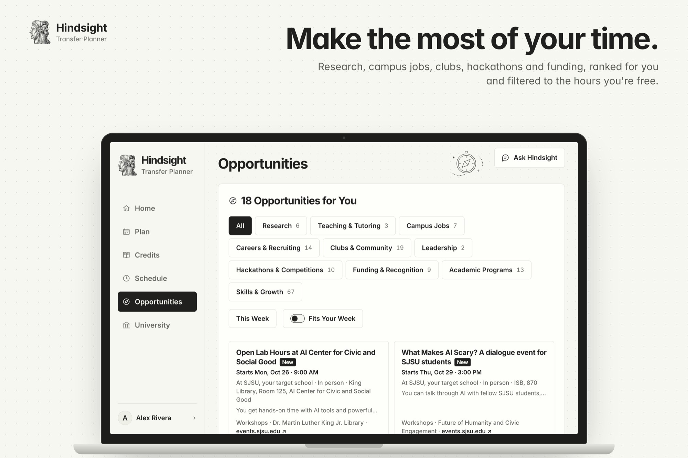
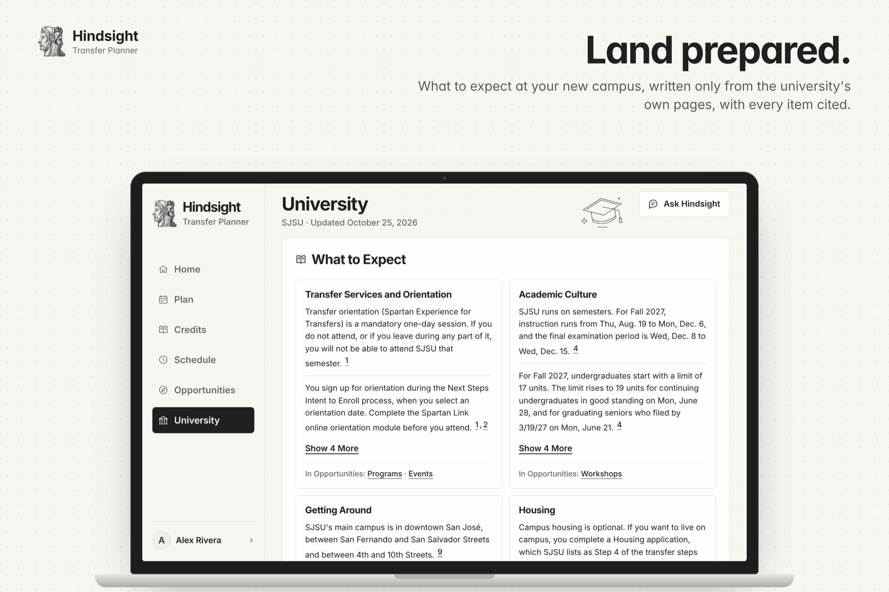
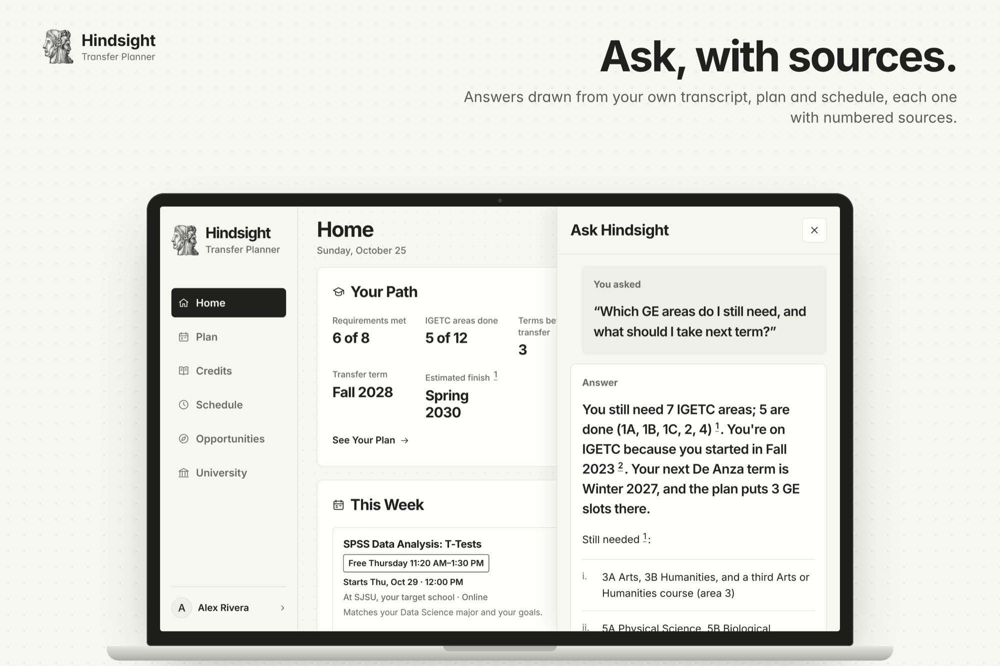
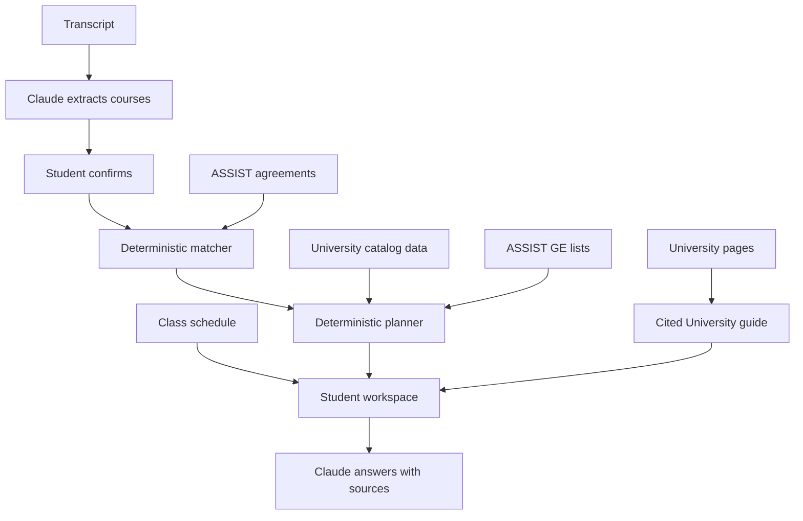
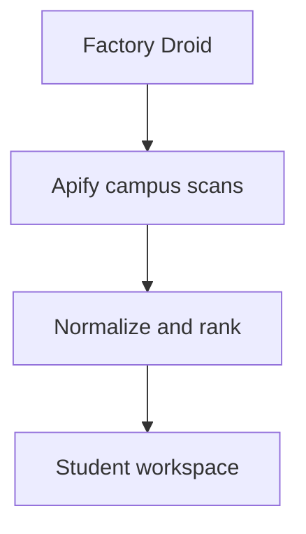

<p align="center">
  
</p>

<p align="center">
  <a href="https://hindsight-web-yl0k.onrender.com">Live app</a> ·
  <!-- VIDEO LINK -->Demo video (coming soon) ·
  <a href="https://devpost.com/software/hindsight-68sruh">Devpost</a> ·
  <a href="#run-locally">Run locally</a>
</p>

**Your whole path through college, in one place: what your credits count for, a plan for every term, and what's worth your time this week.**

Hindsight is a transfer planner for California community-college students, from the first class to graduation. It works for any of California's 116 community colleges and every university each one has ASSIST agreements with. Every answer cites its source.

[](https://hindsight-web-yl0k.onrender.com)

## Why we built it

Three of us, Atishay, Karthik and Amaan, transferred from California community colleges to a CSU or UC. Shiv works in the admissions office at Texas State University and answers transfer-credit questions every day.

Advising meant reading ASSIST together. It never felt personal, and everyone took the same classes without knowing why. A course can transfer as credit and still not count toward the major. An unfinished sequence, a changed course number or an agreement from the wrong year can change the path to graduation.

Transferring brings its own surprise. Many internships and programs close in August and September, right as the first semester starts. Students then spend a semester or two figuring out a campus they know nothing about. We wanted one place that gets students there prepared.

## What it does

<table>
  <tr>
    <td width="50%" valign="top">
      
      <br><strong>Credits</strong>
      <br>Each open requirement with the coursework that meets it and the ASSIST agreement behind it, plus Cal-GETC or IGETC progress by area.
    </td>
    <td width="50%" valign="top">
      
      <br><strong>Plan</strong>
      <br>Every term through transfer and graduation, with saved classes counted as in progress and a printable education plan.
    </td>
  </tr>
  <tr>
    <td width="50%" valign="top">
      
      <br><strong>Schedule</strong>
      <br>Upload a class schedule, confirm the rows, and see the week with free time and the classes that count toward the plan.
    </td>
    <td width="50%" valign="top">
      
      <br><strong>Opportunities</strong>
      <br>Campus listings ranked against majors, goals and interests, with dates, one reason each and source links.
    </td>
  </tr>
  <tr>
    <td width="50%" valign="top">
      
      <br><strong>University</strong>
      <br>What to expect at the university, written only from its own pages, every item cited.
    </td>
    <td width="50%" valign="top">
      
      <br><strong>Ask</strong>
      <br>A panel on every page that answers from the student's own records, with numbered sources.
    </td>
  </tr>
</table>

Credits, GE progress and community-college terms work for every college and university pair. The full plan through graduation covers San José State University's Data Science, B.S. and Economics, B.S. SJSU also has the first University guide and campus opportunities feed.

*Screens show a fictional student. They are not a live evaluation of a real student.*

<details>
<summary><strong>Every page in detail</strong></summary>

<br>

| Page | What the student gets |
|---|---|
| **Home** | This week's moves: the next planned course and what it counts toward, the most important missing GE area, the next transfer or financial-aid deadline, and opportunities that fit the student's free time. Beside them: the path at a glance (requirements met, GE areas done, terms before transfer, transfer term, estimated finish) and today's and the next classes. |
| **Plan** | The transfer and finish terms, then the full course plan in two phases: community-college terms before transfer, then university semesters through graduation. The next two terms are open; later and completed terms are one-line rows. Classes on the saved schedule count as in progress. Below: progress, items needing attention, start and transfer-term controls and a printable education plan. |
| **Credits** | Each open university requirement with the coursework that meets it, accepted alternatives, confidence and the ASSIST agreement behind it (met ones fold into one row), plus Cal-GETC or IGETC progress area by area from the college's ASSIST lists for the year each course was taken. |
| **Schedule** | Upload a class schedule, confirm the rows, and see the week grid with free time and which classes count toward the plan. |
| **Opportunities** | Compact campus listings ranked against majors, goals and interests, with dates, one reason each and source links, filterable to this week or to the student's free time. |
| **University** | What to expect at the student's university (orientation, academics, getting around, housing, student life, first-semester tips), written only from the university's own pages, every item cited; two items per section, the rest one click away. |
| **Ask Hindsight** | A panel on every page. Questions and follow-ups answered from the student's transcript, matches, plan, GE progress, class schedule, University guide and opportunities, with numbered sources. |

Onboarding asks where the student is now (high school, community college, transferred or returning), then the college, university and majors in ASSIST's order. A transcript upload is optional: students with no courses yet can continue without one. The interface leads with the student's next decision. Operational scan and scraper-repair logs are available through the API.

</details>

## Try the demo

1. Open the [live app](https://hindsight-web-yl0k.onrender.com) and create a profile. Pick **De Anza College**, **San José State University**, and **Data Science, B.S.**, **Economics, B.S.**, or both for the full planning demo.
2. Upload the [fictional De Anza sample transcript](tests/fixtures/personas/p1-baseline-deanza.pdf), then review and confirm the course rows. Or continue with no courses.
3. Open **Plan** for the next courses and the full plan through graduation. Change the start or transfer term.
4. Open **Credits** for requirement matches and GE progress by area.
5. On **Schedule**, upload the [sample class schedule](apps/api/tests/fixtures/schedule/sample-schedule.pdf) and confirm it.
6. Back on **Home**, see this week's moves and the opportunities that fall in your free time.
7. Open **Ask Hindsight** and try **“Which GE do I still need?”**, **“When am I free on Thursday?”** or **“What's orientation like at SJSU?”**
8. Read **University** for SJSU's What to Expect guide.

> [!NOTE]
> The hosted API may take a moment to wake after inactivity. The first personalized opportunity feed can also take longer while its explanations are prepared.

## How it works

Credits and plan: the transcript becomes checked credits, a term-by-term plan and cited answers.



Campus opportunities: Droid scans campus sources on a schedule and ranks what it finds.



**Academic decisions come from code and source data.** The matcher handles course groups, alternatives, sequence rules, minimum grades, in-progress coursework and agreement years. It flags renumbered or ambiguous matches. GE progress checks each course against the college's Cal-GETC or IGETC list for the year it was taken. The planner schedules remaining major coursework around the prerequisites in the data, then fills missing GE areas before transfer. Free time comes from the saved class schedule.

**Claude explains the results.** It extracts transcript and class-schedule rows, writes opportunity explanations, writes the University guide from the university's own pages, and answers questions from the student's data. Code drops any guide item whose quote isn't on the page it cites. For supported what-if questions, the counselor calls the matcher and planner. Citation IDs are checked against the sources given to the model.

**Every school goes through the same code.** The app names no college or university. What we know about a school beyond ASSIST lives in its campus registry entry, [`data/campuses/<ASSIST id>.json`](data/campuses/README.md), looked up by the ASSIST ids on the student's profile: display and short names, term system, curated degree requirements, opportunity sources, recurring programs and University-guide pages. A school with no entry still gets credits, GE progress and community-college terms from ASSIST. Adding its requirements or sources is a data change, not a code change. A test fails if application code names a school, an ASSIST id or a campus key.

**Campus data comes from source pages.** Apify's existing Cheerio Scraper Actor fetches curated calendars and listings. Extractors normalize the results and deterministic code ranks them. Missing dates stay empty, and every listing links to its original page.

## Built with

| Technology | Role |
|---|---|
| **Anthropic Claude** | Transcript and class-schedule extraction, source-grounded questions, opportunity explanations, and the cited University guide. |
| **Factory Droid SDK** | Scheduled campus operations and permission-scoped extractor repair. |
| **Apify** | Cheerio Scraper for campus event and opportunity sources and the University guide's pages. |
| **ASSIST** | Official California articulation agreements and Cal-GETC / IGETC course lists, accessed through the public site's API and cached. |
| **React, TypeScript, Vite** | Responsive student workspace and PWA manifest. |
| **FastAPI, Python** | Matching, planning, service integrations, and typed API responses. |
| **Supabase** | Profiles, confirmed coursework, class schedules, cached agreements and GE lists, opportunities, and run events. |
| **Render** | Static frontend and a shared API/agent container. |

The Janus mark connects hindsight with foresight: completed coursework on one side, the path ahead on the other. The interface uses off-white paper, bold black typography and simple school illustrations. See [DESIGN.md](DESIGN.md).

## How Droid is used

The Factory Droid SDK powers the background service in [`apps/agent`](apps/agent). Scheduled runs scan campus sources, rank results and write opportunity alerts.

<details>
<summary><strong>Permission model</strong></summary>

<br>

When a source returns empty results or an extraction error, Droid can inspect the fetched page, repair that source's extractor, and rerun extraction to check the fix.

Its permissions are deliberately narrow:

- Only existing extractor files associated with failed sources may be patched, with a per-run patch budget.
- Shell commands and direct web access are denied; campus operations go through scoped tools.
- The API and agent use separate OS users in the production container. API credentials are withheld from the agent, and run logs redact secrets.
- Plans, steps, patches, results, and errors are recorded in `agent_events`. Repairs live on the container's disk; a redeploy resets them, while recorded diffs remain available for review.

Runs default to every two hours. New profiles trigger ranking and alerts; manual scans are available through `POST /agent/run`. Inspect a run with `GET /agent/events?run_id=…` in the [API docs](https://hindsight-ul94.onrender.com/docs). Run details are available through the API for technical review.

The optional `npm run smoke:live` command in `apps/agent` exercises a real repair session against a temporary broken extractor and stubbed API. It uses Factory credits. See [the engineering decisions](DECISIONS.md) for the permission model and deployment tradeoffs.

</details>

## Accuracy, privacy and current limits

Students confirm every extracted row, and every decision keeps its source.

<details>
<summary><strong>What is checked, what is stored, and what isn't covered yet</strong></summary>

<br>

- **The student confirms the transcript and schedule.** Uploaded files are sent to Anthropic for extraction and are not stored by Hindsight. Only the rows the student confirms are saved in Supabase.
- **Sources stay attached to decisions.** Requirement matches link to ASSIST agreements; GE areas link to the ICAS standards and ASSIST lists; curated university requirements link to catalog pages; University guide items and deadlines link to official pages. A missing published equivalency is not presented as a rejected transfer-credit decision.
- **A proposal is not a confirmed schedule.** Actual course offerings have not been verified. University requirements use the SJSU 2025–26 catalog and have not yet been checked against 2026–27.
- **The plan covers major requirements and GE.** Total degree units, residency, and graduation applications are outside the current audit. AP and IB credit and courses from other colleges aren't counted toward GE yet. Requirements without a course list, including Data Science domain electives, remain unscheduled and are excluded from the estimated finish term.
- **Coverage is limited.** Every ASSIST college and university pair gets credits, GE and community-college terms, but only SJSU's Data Science and Economics have a plan through graduation, and only SJSU has a University guide and an opportunities feed. Current profile recovery depends on the same browser; cross-device accounts and persistent conversations are future work.

Recorded integration checks and persona findings are in [AUDIT.md](AUDIT.md), with the revision and date of that audit. Test documents in [`tests/fixtures/personas`](tests/fixtures/personas) are fictional.

</details>

<details id="run-locally">
<summary><strong>Run locally</strong></summary>

<br>

Requirements: **Node.js 22+**, **Python 3.12+**, and **[uv](https://docs.astral.sh/uv/)**.

```bash
git clone https://github.com/Cal-Hacks-2026/Hindsight.git
cd Hindsight
cp .env.example .env
npm install
(cd apps/api && uv sync)
```

Fill in the relevant credentials in the root `.env`:

| Variables | Enables |
|---|---|
| `SUPABASE_URL`, `SUPABASE_SERVICE_ROLE_KEY` | Profile and course persistence, agreement caching, and opportunity storage. Required for onboarding. |
| `ANTHROPIC_API_KEY` | Transcript extraction and the counselor. `ANTHROPIC_MODEL` is an optional override. |
| `APIFY_TOKEN` | Campus scraping. |
| `PUBLIC_API_URL`, `APIFY_WEBHOOK_SECRET` | Webhook delivery for asynchronous scans, when used. |
| `FACTORY_API_KEY`, `AGENT_SECRET` | Droid operations. Scheduling, campus selection, model, and limits are configured in `.env.example`. |
| `VITE_API_URL` | Browser API address; defaults to `http://localhost:8000`. Never put secrets in `VITE_*` variables. |

Start each service in a separate terminal, from the repository root:

```bash
# API: http://localhost:8000 — interactive docs at /docs
(cd apps/api && uv run uvicorn app.main:app --reload --port 8000)
```

```bash
# Web: http://localhost:5173
npm run dev:web
```

```bash
# Optional background agent: http://127.0.0.1:8787
(cd apps/agent && npm install && npm start)
```

The API reads `.env` at startup; restart it after changing credentials. `/health` reports configuration readiness. With Apify and storage configured, populate the feed using `(cd apps/api && uv run python -m app.scan sjsu)`.

### Checks

```bash
npm run typecheck
npm run build:web
(cd apps/api && uv run pytest)
(cd apps/agent && npm test && npm run typecheck)
```

### Deployment

Build the web app with `npm run build:web` and serve `apps/web/dist` with a fallback to `index.html`. Set `VITE_API_URL` before the build. The root [`Dockerfile`](Dockerfile) runs the API and agent in one container so extractor repairs are visible to subsequent scans. Set `WEB_ORIGIN` to the frontend's exact origin.

</details>

## What's next

**Hindsight is where a student lands before they land at a university.**

- Compare schools side by side.
- An application timeline built from the transfer term: UC TAG, UC and CSU applications, ADT and financial-aid deadlines.
- The first semester planned before it starts, with the August–September internships and programs surfaced while the student is still at community college.
- Calendar sync and a weekly digest.
- More campuses with full plans, University guides and opportunity feeds.
- Counselor sharing.

See the [product roadmap](docs/ROADMAP.md) for scope and priorities.

## Team

Built by [Atishay Pahadiya](https://github.com/atishaypahadiya) (product, design and engineering), with input from [Shivendra Bhagat](https://github.com/sh1vendra) (admissions and transfer-credit expertise), [Amaan Shaghel](https://github.com/amaanshaghel) and [Dhana Karthikeya Ventrapragada](https://github.com/vdkarthikeya) (transfer-student experience).

Built at [Cal Hacks 13.0](https://devpost.com/software/hindsight-68sruh).
