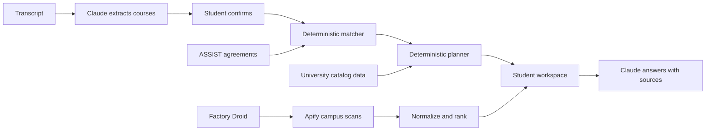

<p align="center">
  
</p>

<h1 align="center">Hindsight</h1>
<p align="center"><strong>Transfer Planner</strong></p>
<p align="center">Know what counts. Know what to take next.</p>

<p align="center">
  <a href="https://hindsight-web-yl0k.onrender.com">Live demo</a> ·
  <a href="#try-the-demo">Demo walkthrough</a> ·
  <a href="#run-locally">Run locally</a> ·
  <a href="docs/ROADMAP.md">Roadmap</a>
</p>

<p align="center">Built at Cal Hacks 13.0</p>

Hindsight helps community-college students turn their transcript into a transfer plan. It checks coursework against official articulation agreements, identifies remaining major requirements, and proposes what to take next. Alongside the plan, students get relevant campus opportunities and answers grounded in their own records.

**The current demo supports De Anza College → San José State University.** Articulation matching uses the majors available for that pathway on ASSIST. Full university course planning covers Data Science, B.S. and Economics, B.S.

[](https://hindsight-web-yl0k.onrender.com)

<details>
<summary>See credit review and Ask Hindsight</summary>

| My credits | Ask Hindsight |
|---|---|
| [](docs/screenshots/transfer-planner/credits.png) | [](docs/screenshots/transfer-planner/ask-hindsight.png) |

</details>

*Screenshots show a fictional student profile. Academic results use recorded test responses; they are not a live evaluation of a real student.*

## Why we built it

A course can transfer as credit without satisfying a student's major. An unfinished sequence, a changed course number, or an agreement from the wrong year can change the path to graduation. Students need those differences explained before they register.

Our teammate Atishay transferred from De Anza to SJSU to study Data Science and Economics. His advising experience stopped at reading ASSIST; he still needed to understand what his own transcript satisfied and what to take next. He also discovered a student program after applications had closed.

Hindsight brings those decisions together: **what counts, what comes next, and what needs attention.**

## The student experience

| Step | What the student gets |
|---|---|
| **Confirm coursework** | Upload a transcript PDF or image, review the extracted courses, and correct names, grades, units, or terms before matching. Students with no completed coursework can continue without a transcript. |
| **My plan** | Next-term course proposals, requirements needing attention, progress, and a full course sequence with start and transfer-term controls. |
| **My credits** | The university requirement, matched prior coursework, accepted alternatives, confidence, and the agreement behind each result. |
| **Opportunities** | Campus listings ranked against majors, goals, and interests, with source links and dates. |
| **Ask Hindsight** | Questions and follow-ups grounded in the student's confirmed transcript, computed matches, plan, and opportunities. |

The interface leads with the student's next decision. Operational scan and scraper-repair logs are available through the API.

## Try the demo

1. Open the [live app](https://hindsight-web-yl0k.onrender.com) and create a profile. Choose **Data Science, B.S.**, **Economics, B.S.**, or both for the full planning demo.
2. Upload the [fictional De Anza sample transcript](tests/fixtures/personas/p1-baseline-deanza.pdf), then review and confirm the course rows.
3. Open **My plan** to see proposed next courses. Change the start or transfer term and inspect the full sequence.
4. Open **My credits** to inspect requirement matches, incomplete sequences, and credits recognized under earlier agreements.
5. Ask **“Which requirements need attention before I transfer?”** or **“What changes if I drop my second major?”**
6. Explore **Opportunities** for the profile's ranked campus listings.

The hosted API can take time to wake after inactivity. The first personalized opportunity feed may also take longer while its explanations are prepared.

## How it works



**Academic decisions come from code and source data.** The matcher handles course groups, alternatives, sequence rules, minimum grades, in-progress coursework, and agreement years. Renumbered or ambiguous matches are flagged. The planner schedules remaining coursework around the prerequisite relationships represented in the data.

**Claude explains the results.** It extracts transcript rows, writes opportunity explanations, and answers questions using the student's data. For supported what-if questions, the counselor calls the matcher and planner. Citation IDs are checked against the sources supplied to the model.

**Campus data comes from source pages.** Apify's Cheerio Scraper fetches curated calendars and listings. Extractors normalize the results; deterministic code ranks them. Missing dates remain empty, and every listing links to its original page. Campus collection uses Apify’s existing Cheerio Scraper Actor.

## How Droid is used

The Factory Droid SDK powers the background service in [`apps/agent`](apps/agent). Scheduled runs scan campus sources, rank results, and write opportunity alerts. When a source returns empty results or an extraction error, Droid can inspect the fetched page, repair that source's extractor, and rerun extraction to check the fix.

Its permissions are deliberately narrow:

- Only existing extractor files associated with failed sources may be patched, with a per-run patch budget.
- Shell commands and direct web access are denied; campus operations go through scoped tools.
- The API and agent use separate OS users in the production container. API credentials are withheld from the agent, and run logs redact secrets.
- Plans, steps, patches, results, and errors are recorded in `agent_events`. Repairs live on the container's disk; a redeploy resets them, while recorded diffs remain available for review.

Runs default to every two hours. New profiles trigger ranking and alerts; manual scans are available through `POST /agent/run`. Inspect a run with `GET /agent/events?run_id=…` in the [API docs](https://hindsight-ul94.onrender.com/docs). Run details are available through the API for technical review.

The optional `npm run smoke:live` command in `apps/agent` exercises a real repair session against a temporary broken extractor and stubbed API. It uses Factory credits. See [the engineering decisions](DECISIONS.md) for the permission model and deployment tradeoffs.

## Built with

| Technology | Role |
|---|---|
| **Anthropic Claude** | Transcript extraction, source-grounded questions, and opportunity explanations. |
| **Factory Droid SDK** | Scheduled campus operations and permission-scoped extractor repair. |
| **Apify** | Cheerio Scraper for campus event and opportunity sources. |
| **ASSIST** | Official California articulation agreements, accessed through the public site's API and cached. |
| **React, TypeScript, Vite** | Responsive student workspace and PWA manifest. |
| **FastAPI, Python** | Matching, planning, service integrations, and typed API responses. |
| **Supabase** | Profiles, confirmed coursework, cached agreements, opportunities, and run events. |
| **Render** | Static frontend and a shared API/agent container. |

The Janus mark connects hindsight with foresight: completed coursework on one side, the path ahead on the other. The current interface uses off-white paper, bold black typography, and simple school illustrations. See [DESIGN.md](DESIGN.md).

## Accuracy, privacy, and current limits

- **The student confirms the transcript.** The uploaded file is sent to Anthropic for extraction and is not stored by Hindsight. Confirmed course rows are saved in Supabase.
- **Sources stay attached to decisions.** Requirement matches link to ASSIST agreements; curated university requirements link to catalog pages. A missing published equivalency is not presented as a rejected transfer-credit decision.
- **A proposal is not a confirmed schedule.** Actual course offerings have not been verified. University requirements use the SJSU 2025–26 catalog and have not yet been checked against 2026–27.
- **The plan covers major requirements.** General education, total degree units, residency, and graduation applications are outside the current audit. Requirements without a course list, including Data Science domain electives, remain unscheduled and are excluded from the estimated finish term.
- **Coverage is limited.** Berkeley campus sources exist, but Berkeley onboarding and nationwide academic planning are not available. Current profile recovery depends on the same browser; cross-device accounts and persistent conversations are future work.

Recorded integration checks and persona findings are in [AUDIT.md](AUDIT.md), with the revision and date of that audit. Test documents in [`tests/fixtures/personas`](tests/fixtures/personas) are fictional.

## Run locally

Requirements: **Node.js 22+**, **Python 3.12+**, and **[uv](https://docs.astral.sh/uv/)**.

```bash
git clone https://github.com/Cal-Hacks-2026/Hindsight.git
cd Hindsight
cp .env.example .env
npm install
(cd apps/api && uv sync)
```

Fill in the relevant credentials in the root `.env`:

| Variables | Enables |
|---|---|
| `SUPABASE_URL`, `SUPABASE_SERVICE_ROLE_KEY` | Profile and course persistence, agreement caching, and opportunity storage. Required for onboarding. |
| `ANTHROPIC_API_KEY` | Transcript extraction and the counselor. `ANTHROPIC_MODEL` is an optional override. |
| `APIFY_TOKEN` | Campus scraping. |
| `PUBLIC_API_URL`, `APIFY_WEBHOOK_SECRET` | Webhook delivery for asynchronous scans, when used. |
| `FACTORY_API_KEY`, `AGENT_SECRET` | Droid operations. Scheduling, campus selection, model, and limits are configured in `.env.example`. |
| `VITE_API_URL` | Browser API address; defaults to `http://localhost:8000`. Never put secrets in `VITE_*` variables. |

Start each service in a separate terminal, from the repository root:

```bash
# API: http://localhost:8000 — interactive docs at /docs
(cd apps/api && uv run uvicorn app.main:app --reload --port 8000)
```

```bash
# Web: http://localhost:5173
npm run dev:web
```

```bash
# Optional background agent: http://127.0.0.1:8787
(cd apps/agent && npm install && npm start)
```

The API reads `.env` at startup; restart it after changing credentials. `/health` reports configuration readiness. With Apify and storage configured, populate the feed using `(cd apps/api && uv run python -m app.scan sjsu)`.

### Checks

```bash
npm run typecheck
npm run build:web
(cd apps/api && uv run pytest)
(cd apps/agent && npm test && npm run typecheck)
```

### Deployment

Build the web app with `npm run build:web` and serve `apps/web/dist` with a fallback to `index.html`. Set `VITE_API_URL` before the build. The root [`Dockerfile`](Dockerfile) runs the API and agent in one container so extractor repairs are visible to subsequent scans. Set `WEB_ORIGIN` to the frontend's exact origin.

## What's next

Expand verified institution pairs, compare transfer destinations, add general-education and admission checks, incorporate actual course offerings and student schedules, and prepare course-evaluation requests. The same workflow should work across institutions as coverage grows. See the [product roadmap](docs/ROADMAP.md) for scope and priorities.

## Team

[Atishay Pahadiya](https://github.com/atishaypahadiya) · [Shivendra Bhagat](https://github.com/sh1vendra) · [Amaan Shaghel](https://github.com/amaanshaghel) · [Dhana Karthikeya Ventrapragada](https://github.com/vdkarthikeya)
