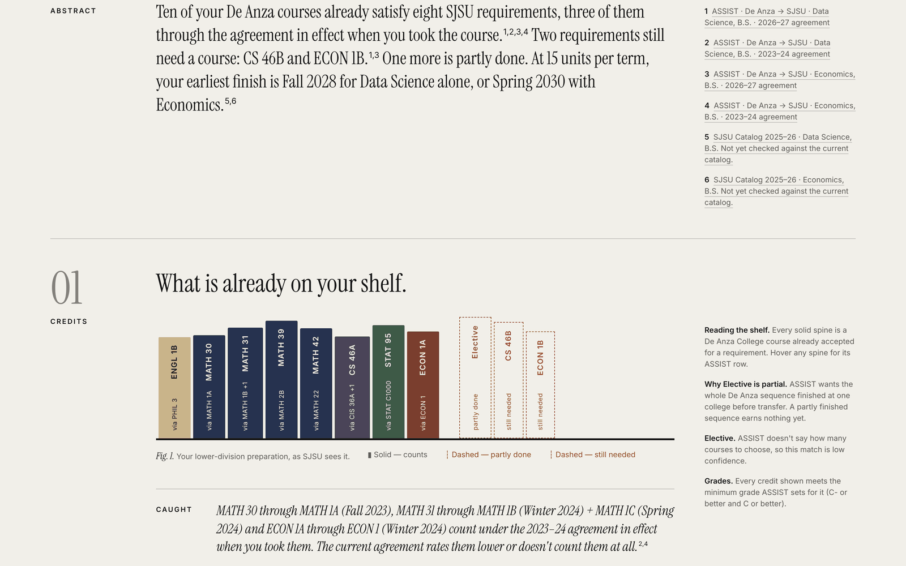
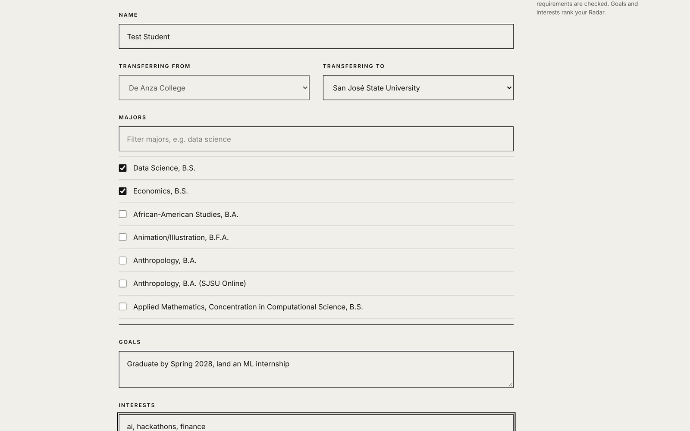
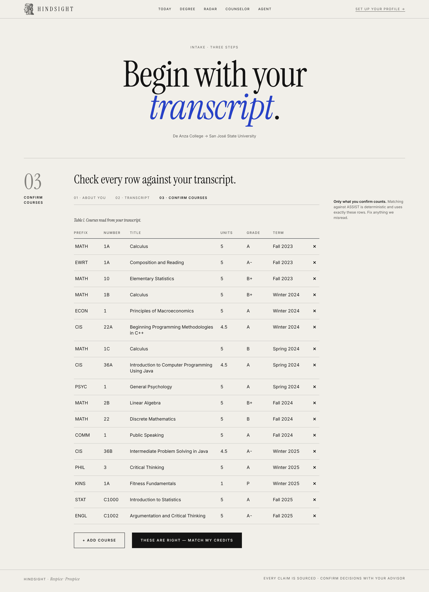
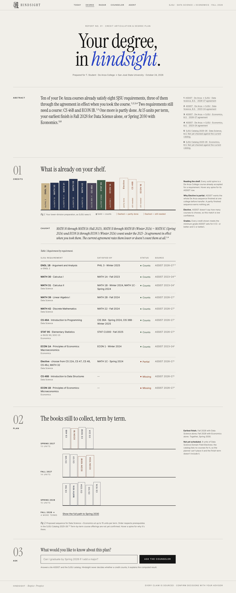
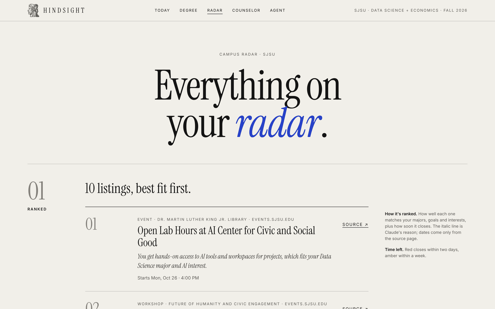
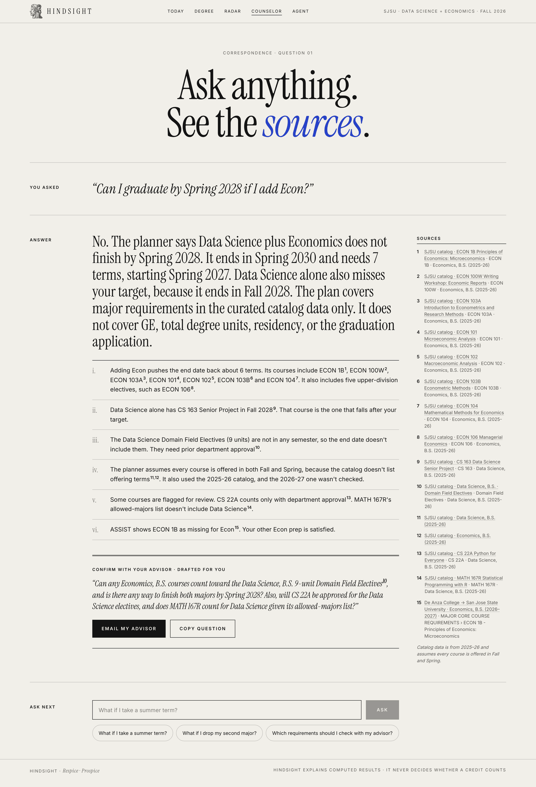
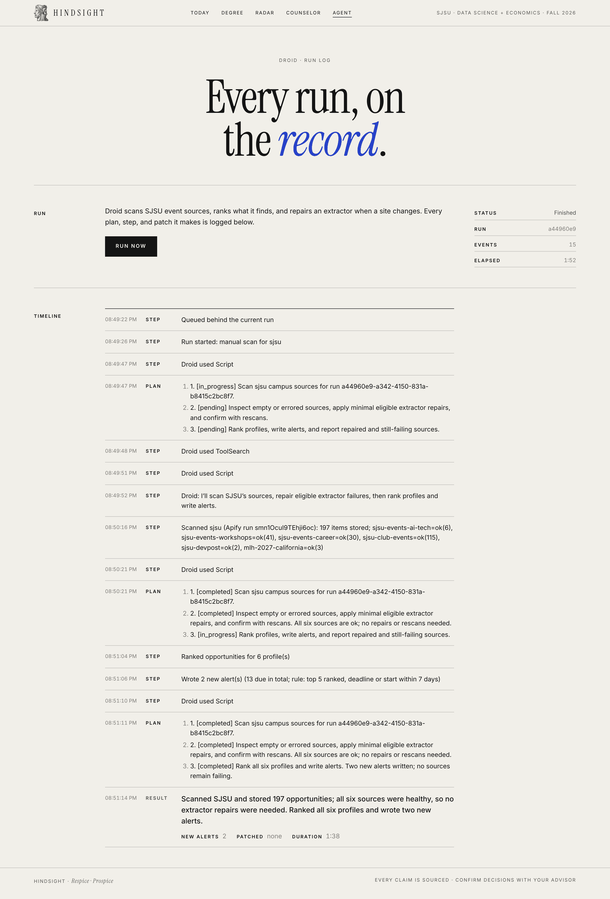

<p align="center">
  
</p>

<h1 align="center">Hindsight</h1>

<p align="center"><em>Everything you'd wish you knew, before you need it.</em></p>

<p align="center">
  <a href="https://hindsight-web-yl0k.onrender.com">Open the app</a> ·
  <a href="PROJECT.md">Project write-up</a> ·
  <a href="DESIGN.md">Design language</a> ·
  <a href="DECISIONS.md">Decision log</a>
</p>

An AI counselor for California community-college transfer students. It reads your transcript against the official ASSIST articulation agreements, shows what already counts and what's left, plans the rest term by term, and watches campus for the events and opportunities you'd otherwise hear about after the deadline. Every claim it makes is cited.

Built in 36 hours at Cal Hacks 13.0.

[](https://hindsight-web-yl0k.onrender.com)

<sub>The Degree page for a sample De Anza → SJSU transcript, captured from the live deployment. Solid spines count, dashed ones are still needed, and the "Caught" note flags credits that only count under the agreement in effect when the course was taken.</sub>

## Why this exists

Four-year students learn how a university works over two years: which credits count, which clubs matter, which programs open in August and close in September. Transfer students arrive as juniors with half the time and none of the map.

I transferred from De Anza to SJSU this fall. My counselor read me the ASSIST page. Nobody told me, for my exact transcript and my two majors, what counted, what was missing, or in what order to take the rest. And I found out about a major AI-company student program a month after it closed.

ChatGPT answers the questions you know to ask. A transfer student's problem is the questions they don't know to ask.

## Who it's for

- **Community-college transfers at a CSU.**
  Today: De Anza → San José State, with every major ASSIST lists for that pair (149) and curated upper-division requirements for Data Science, B.S. and Economics, B.S.
  Next: every sending and receiving pair on ASSIST, since the matcher reads any agreement.
- **Transfers headed to UC Berkeley.**
  Today: Campus Radar scans Berkeley's event calendars. The ASSIST pair resolves (95 majors).
  Next: curated Berkeley major requirements, so the Degree plan works there too.
- **Transfer counselors.**
  Next: a cited, shareable report for each advising appointment, so the meeting starts from the student's actual gaps.

## What it does

```
          Transcript PDF / image
                    │
                    ▼
   Claude reads it ─► Student confirms every row
                    │
                    ▼
 ┌──────────────────┴───────────────────┐
 │ ASSIST client (XSRF handshake, cache) │──► Deterministic matcher ──► Degree plan
 │  agreement for the year each course   │    And/Or groups, N-of,       prerequisites,
 │  was taken, renumbering fallback      │    sequence rule, grade min   15-unit terms
 └───────────────────────────────────────┘
                    │
                    ▼
 Apify (Cheerio Scraper) ─► Campus Radar ─► ranked opportunities, Claude writes the reason
                    ▲
 Factory Droid ─────┘  on a schedule: scan, health-check, repair a broken extractor, alert
                    │
                    ▼
   Claude counselor: answers from the computed results only, cites every claim
```

<table>
  <tr>
    <td width="33%"><a href="docs/screenshots/onboarding.png"></a><br><sub><b>Onboarding.</b> Majors come live from ASSIST.</sub></td>
    <td width="33%"><a href="docs/screenshots/confirm-courses.png"></a><br><sub><b>Confirm.</b> Claude reads the transcript; you check every row.</sub></td>
    <td width="33%"><a href="docs/screenshots/degree-full.png"></a><br><sub><b>Degree.</b> What counts, what's left, and the plan.</sub></td>
  </tr>
</table>

### Transcript in, confirmed by you

Upload a PDF or a photo. Claude extracts each course (prefix, number, title, units, grade, term) and hands back an editable table. Nothing is matched until the student confirms it, so a misread course can't quietly change a plan.

### Credits, matched against ASSIST

Matching is deterministic code. Claude never decides whether a credit counts.

- The client performs ASSIST's XSRF handshake, then fetches agreements and caches them in Supabase, since the API is unofficial.
- Majors are matched by exact label, so "Data Science, B.S." never matches "Population Data Science".
- The evaluator handles `Following`, `NFromArea`, `NFromFollowing`, choose-N sections, And-within-group and Or-between-groups, "no current articulation", "complete entire sequence at the same institution", minimum grades, and Pass grades.
- **Year-of-course matching.** California community colleges renumbered many courses (ECON 1 became ECON C2002). Each course is checked against the agreement for the academic year it was taken, so older credits still count. Courses missing from every loaded agreement fall back to a strict title-and-units similarity match, flagged low confidence.
- Every requirement carries a status (counts, partial, missing, take at SJSU), flags, a confidence level, and a citation to its ASSIST row.

### The plan

The planner takes the curated SJSU catalog requirements (2025–26, page-linked on every item), drops what the transcript or the ASSIST match already covers, and schedules the rest into terms of up to 15 units that respect prerequisite order. It plans major requirements only. The Degree page notes that term-by-term course offerings aren't confirmed yet, and the counselor is told the plan doesn't cover GE, total degree units, residency, or the graduation application.

### Campus Radar

<a href="docs/screenshots/radar.png"></a>

Twelve verified sources (SJSU and Berkeley event calendars, SJSU student-org events, Devpost, MLH) are scraped with Apify's Cheerio Scraper. Dates and links come only from the source page; a missing date stays empty. Scoring is plain code (interests, majors, goals, deadline urgency, item type); Claude writes only the one-line reason. Faculty-only events are filtered out.

### The counselor

<a href="docs/screenshots/counselor.png"></a>

Claude answers from this student's data only: profile, confirmed courses, match results, plan, and top opportunities. For what-if questions it calls the real planner and matcher as tools instead of estimating. Claude cites source IDs, never URLs; the server drops any ID that doesn't exist. When something is uncertain, it says so and drafts the question to ask an advisor.

### Droid, on a schedule

<a href="docs/screenshots/agent.png"></a>

See [How Droid is used](#how-droid-is-used) below.

### Where it could go wrong, and what we did about it

| Risk | Design |
|---|---|
| A wrong credit decision costs a student a semester | Matching is deterministic code over official ASSIST data. Claude only explains computed results. |
| A misread transcript | The student confirms every extracted row before anything is matched. |
| An invented fact | Every academic claim cites an ASSIST row or a catalog page. Unknown citation IDs are dropped server-side. |
| Stale or renumbered courses | Year-of-course agreements, plus a low-confidence fallback that is always flagged. |
| A made-up event or deadline | Radar shows only scraped items, linked to their source. Missing dates stay empty. |
| Uncertainty | Confidence on every requirement, and a drafted advisor question whenever the answer depends on a human decision. |

## How Droid is used

Droid is the agent that keeps Campus Radar fresh. It does real work in the running product, not in a chat window.

**What it does.** Each run, Droid (through `@factory/droid-sdk` in `apps/agent`):

1. writes a plan (its TodoWrite list),
2. scans the campus's sources on Apify (`scan_campus`),
3. **self-heals**: if a source comes back `empty` or with an `extractor_error`, it reads the fetched page data and that source's extractor, patches the extractor with the smallest fix, and re-runs the scan's extraction on the same fetched pages (`rescan`) to confirm the source is `ok`,
4. re-ranks every profile's Radar feed (`rank_profiles`),
5. writes alerts (`write_alerts`): a profile's top 5 ranked items whose deadline (or start) is within 7 days get `notified = true`,
6. finishes with a structured summary.

Every plan, step, diff, result, and error is a row in Supabase `agent_events`, served by `GET /agent/events?run_id=`, which the `/agent` page reads. A patch is recorded as a `diff` row with the unified diff.

**Triggers.**
- Schedule: every `AGENT_INTERVAL_MINUTES` (default 120, to conserve credits; `0` turns it off) for each campus in `AGENT_CAMPUSES`.
- Manual: `POST /agent/run {campus}` (the demo button). A click within `AGENT_MANUAL_COOLDOWN_MINUTES` (default 2) of the last manual run for that campus returns that run's id, instead of starting another paid run.
- New profile: `POST /profiles` hands the agent a `profile_created` run that ranks and alerts for that profile only (no scan). Since anyone can create a profile, `POST /profiles` is limited to 20 per IP per minute (its own bucket, separate from the Claude endpoints), and at most `AGENT_PROFILE_RUNS_PER_HOUR` (default 6) of these runs start a Droid session; past that, the agent ranks and alerts directly and logs why.

**How it runs.** The Node SDK starts the `droid` CLI (npm package `droid`, pinned in `apps/agent`) as a local subprocess and talks to it over stdio. There's no daemon; the model runs on Factory's side with `FACTORY_API_KEY`, and tools run on this machine. In production the API and the agent share one container (`Dockerfile`, `scripts/start-container.sh`). The API is public on `$PORT`, and the agent listens only on `127.0.0.1:8787`. They have to share a disk: Droid patches extractor files, and the API runs them on the next re-scan. A redeploy resets patches; the `diff` rows are how a human turns a good patch into a PR. **Droid never commits.**

```
web /agent ──GET /agent/events──────────────────────────┐
web "Run now" ──POST /agent/run──► API ──POST /runs──► apps/agent ──stdio──► droid CLI ──► Factory model
POST /profiles ─────────────────► API ──POST /runs──►     │  ▲                    │
                                  ▲                       │  └─ schedule           │ tools: scan_campus, get_source_raw,
                                  └── /internal/agent/* ◄─┘   (AGENT_SECRET)       │ rescan, rank_profiles, write_alerts,
                                      scan · rescan · raw · rank · alerts · events │ ApplyPatch on extractors/ only
```

**What Droid can touch (DECISIONS.md D-003, D-006).**
- **Edits:** only `apps/api/app/services/radar/extractors/<kind>.py`, and within that only the files whose sources failed in this run. Edits must be in-place updates (no creating, deleting, or moving files), with at most `AGENT_MAX_PATCHES` (default 4) per run. It's enforced in `apps/agent/src/policy.ts`, which parses patch text strictly: every `***` control line must be an exact `Update File:` (or Begin/End) line, and the files it names must match the files the CLI reports. The session runs at autonomy **Off**, so every call with a side effect asks that handler first, including calls made inside Droid's Script tool or by a subagent. The handler refuses everything else.
- **No shell, no web.** Shell commands, URL fetches, and web searches all ask for permission and are always refused. Droid reaches the outside world only through our five tools, which are bound to the run's campus (and profile). Droid never sees a profile id.
- **No secrets.** Droid's Read tool can't be gated, so the container keeps secrets out of its reach rather than out of its sight:
  - The agent, and so Droid, runs as its own OS user (`droid`). The API runs as `node`, so Droid can't read the API's environment through `/proc`. The API also marks itself non-dumpable, so even processes running as `node` can't read it.
  - The start script withholds the Supabase, Apify, and Anthropic keys from the agent. It passes `AGENT_SECRET` as a file the agent deletes after reading, and the agent strips its environment to a short allowlist before starting Droid (the SDK passes `process.env` to the CLI).
  - What's left is Droid's own Factory key. The run log redacts it, `AGENT_SECRET`, and anything shaped like an API key before writing, since the log is public.
  - `/internal/agent/*` accepts only loopback connections, so even a leaked `AGENT_SECRET` is useless from outside the container.
  - The API refuses to read an extractor that is a symlink or not a regular file, and the permission handler refuses to patch one, since Droid's user owns that folder.
  - When you run it locally, both processes run as you and the repo-root `.env` is readable. The container has no `.env`.
- **Run logs carry no profile ids.** `/agent/events` is public and a profile id works like a password (it's how a student gets back to their profile), so the internal rank and alerts endpoints return counts and opportunities only.
- **Patched code runs in its own process.** The API runs extractors in a separate Python process (`extract_worker.py`): an empty environment, isolated mode, a timeout, and JSON in and out, all re-validated. A patch can't reach the API's keys or memory.
  - Inside that process, `extract.py` still checks the code first: only allowlisted `from X import Y` imports (`json`, `re`, `html`, `datetime`, `defusedxml`, our helpers), no `open`/`eval`/introspection, no underscore or frame attributes, no `match`, no attribute assignment, and a reduced set of Python built-ins.
  - Each call gets a plain copy of its source config (strings and lists, never the pydantic model, whose methods can read files), and a broken or refused extractor fails only its own sources.
  - The rules that make an item safe to show (http(s) URL, real title, dates only from the source, dedupe) live in `normalize.py`, outside Droid's folder.
- **Page data is untrusted.** Fetched pages reach Droid labelled as third-party data, and the prompt tells it to ignore any instructions inside them. The permission scope above is what limits the damage if it doesn't.

**Try it.** `cd apps/agent && npm run smoke:live` runs one real Droid session against a temporary copy of `extractors/` with `localist.py` deliberately broken and a stubbed API. It uses Factory credits but writes nothing to Supabase or Apify. Droid should patch the extractor, the run should log the diff, and the re-run should report the source `ok`.

**Env.** `FACTORY_API_KEY`, `AGENT_SECRET` (shared by API and agent), `AGENT_INTERVAL_MINUTES`, `AGENT_CAMPUSES`, optional `DROID_MODEL`, `AGENT_MAX_PATCHES`, `AGENT_RUN_TIMEOUT_MINUTES`, `AGENT_PROFILE_RUNS_PER_HOUR`; see `.env.example`.

## Numbers

Measured on the live deployment (Render free tier) on October 24, 2026, with a fictional sample transcript.

| What | Result |
|---|---|
| Courses extracted from the sample transcript | 17 of 17, with correct units, grades, and terms |
| SJSU requirements matched | 8 satisfied, 3 of them only via the 2023–24 agreement; 2 missing; 1 partial |
| ASSIST majors, De Anza → SJSU / → Berkeley | 149 / 95 |
| Radar sources / listings on the first scan | 12 / 255 |
| One Droid run (SJSU) | 6 of 6 sources healthy, 197 items stored, 56 s |
| Radar first load / cached | ~14 s / ~0.4 s |
| Counselor demo answer | 15 cited sources |
| Tests | API 334 passed · agent 24 passed |

## Sponsor tracks

| Track | Where it lives |
|---|---|
| **Anthropic: Claude for Public Benefit** | Community: CA community-college transfers. Claude reads transcripts, writes Radar reasons, and runs the cited counselor. See *Where it could go wrong*. |
| **Factory: Droid SDK** | `apps/agent`. See *How Droid is used*. |
| **Apify** | Cheerio Scraper powers Campus Radar (`apps/api/app/services/radar/`). |
| **Figma** | Screens designed first; see `DESIGN.md` and `design/mockups/`. |

## Run it

Prereqs: Node 20+ (22+ for the agent), Python 3.12+, [uv](https://docs.astral.sh/uv/).

```bash
cp .env.example .env        # fill in Supabase, Anthropic, Apify, Factory keys
npm install

# API → http://localhost:8000 (docs at /docs)
cd apps/api && uv run uvicorn app.main:app --reload --port 8000

# Web → http://localhost:5173
npm run dev:web

# Tests
cd apps/api && uv run pytest
npm run typecheck
```

The Droid agent is optional locally and has its own `package.json` (Node 22+):

```bash
cd apps/agent && npm install
npm start               # agent → http://127.0.0.1:8787; needs FACTORY_API_KEY and AGENT_SECRET in .env
npm test                # node:test suites in test/
npm run typecheck
npm run smoke:live      # one real Droid self-heal session; uses Factory credits
```

## Deploy

One Render web service runs the API and the Droid agent in a single container (see D-006 in `DECISIONS.md`). The web app is a Render static site with a `/* → /index.html` rewrite. `WEB_ORIGIN` on the API must match the site's URL exactly, and `VITE_API_URL` is baked into the web build.

## Layout

```
apps/
  api/      FastAPI: ASSIST, matcher, transcripts, planner, Radar, counselor
  web/      Vite + React 19 PWA, plain CSS on design tokens
  agent/    Factory Droid SDK service: schedule, scan, repair, alerts
  actor/    placeholder; Radar uses Apify's Cheerio Scraper instead (D-002)
packages/
  contracts/  shared API types, mirrored by Pydantic models
data/
  requirements/  curated SJSU major requirements (2025–26 catalog, page-linked)
  sources.json   Radar sources
design/mockups/  the canvas mockups the UI was built from
```

## Data and terms

- **ASSIST** is the official repository of California articulation. Hindsight reads its public site's API and caches every agreement. ASSIST is best used with a counselor, and so is Hindsight.
- **SJSU requirements** are transcribed from the official 2025–26 catalog PDF, with a page link on every item, and are not yet checked against 2026–27.
- **Radar listings** link to their source pages.
- **The Janus mark** is traced from a 19th-century engraving of the Roman god Janus.
- **The sample transcript** in testing is fictional.

## Team

Atishay Pahadiya · Shivendra Bhagat · Amaan Shaghel · Dhana Karthikeya Ventrapragada
