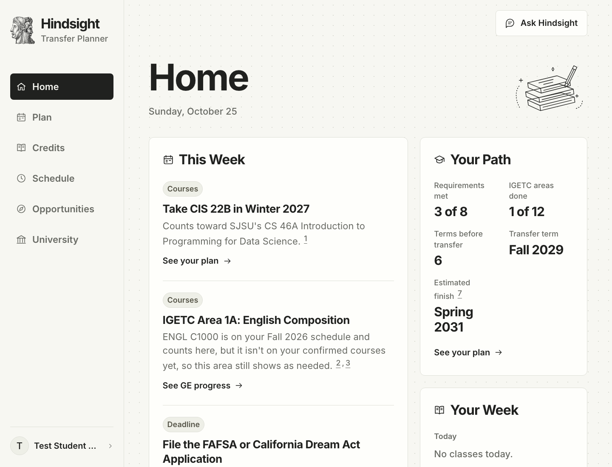
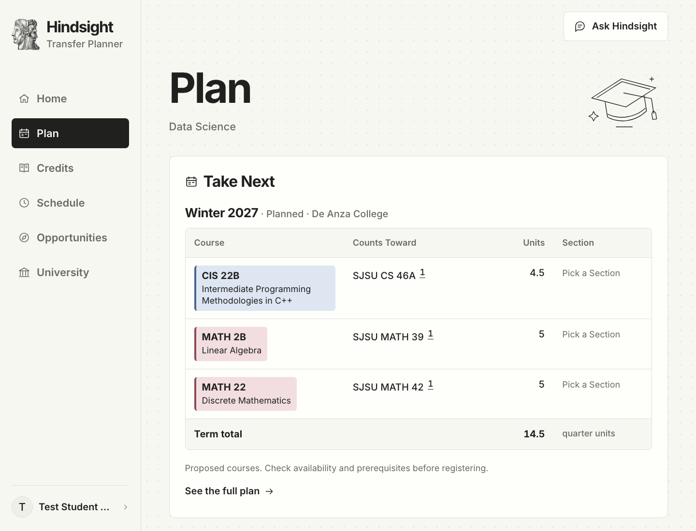
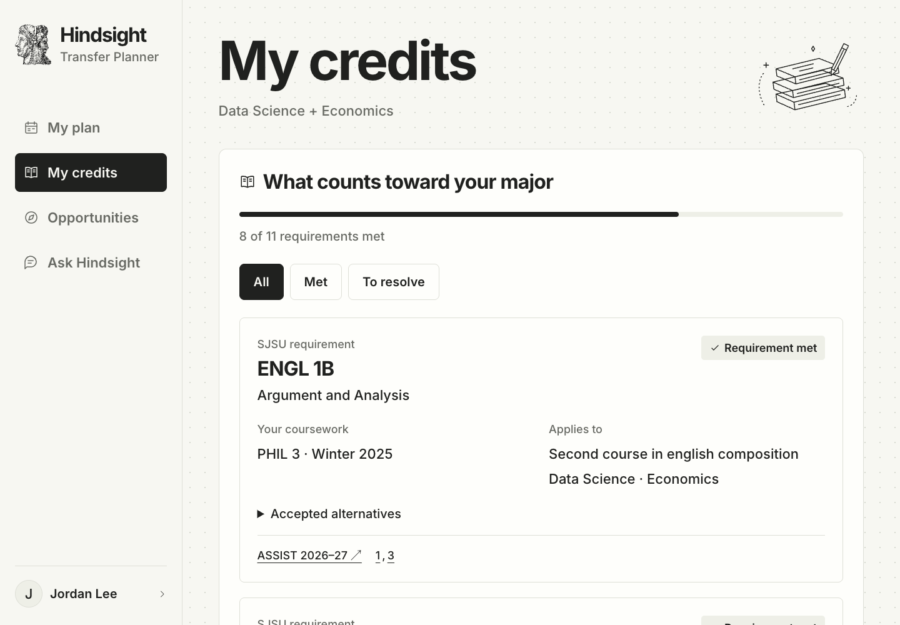
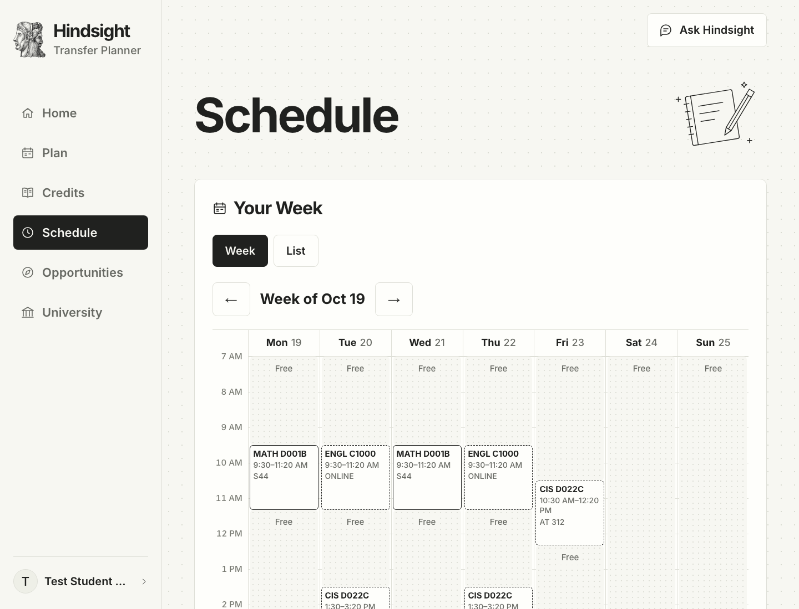
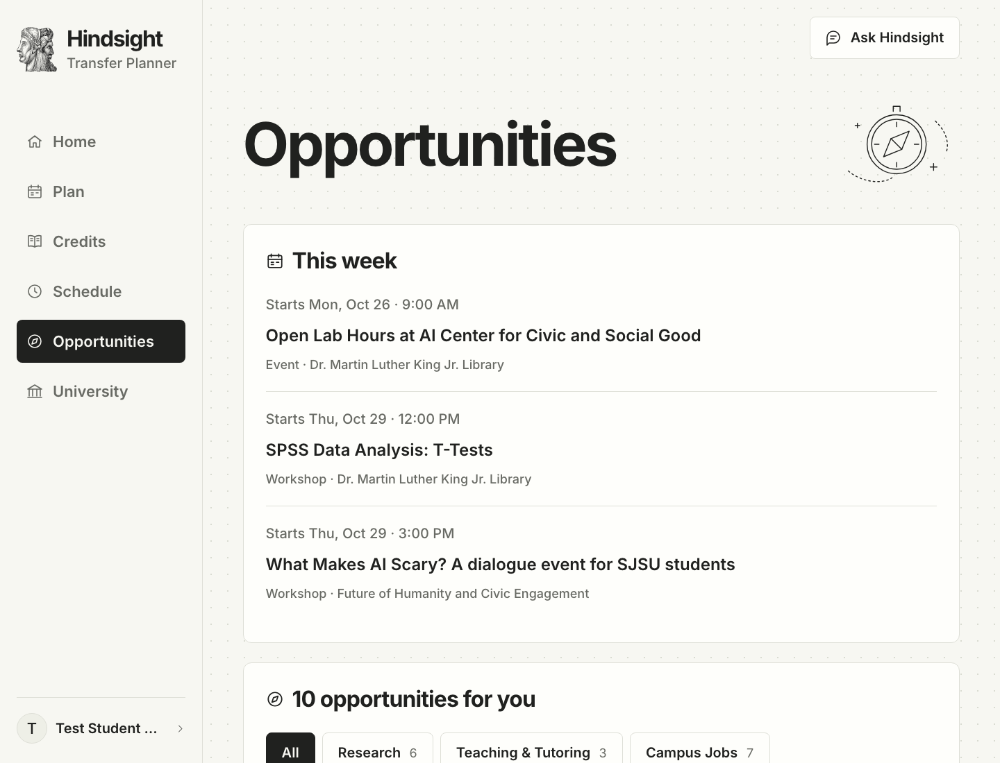
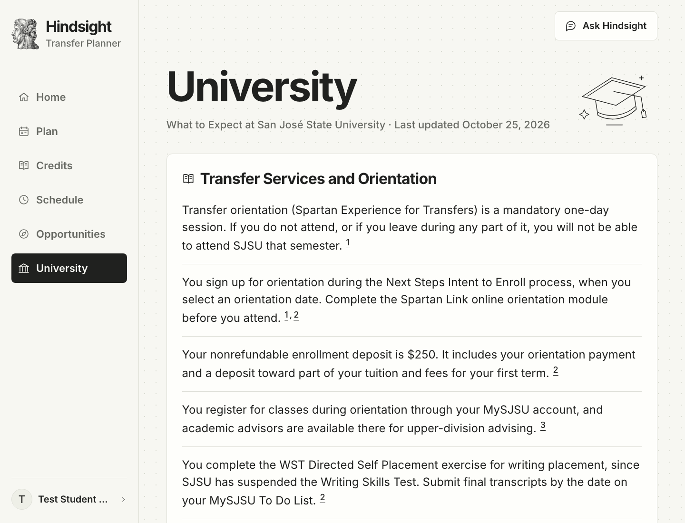
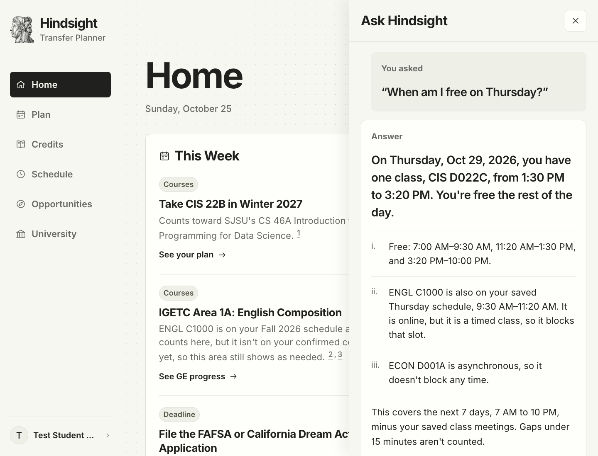
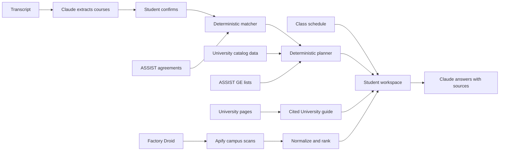

<p align="center">
  
</p>

<h1 align="center">Hindsight</h1>
<p align="center"><strong>Transfer Planner</strong></p>
<p align="center">Know what counts. Know what to take next.</p>

<p align="center">
  <a href="https://hindsight-web-yl0k.onrender.com">Live demo</a> ·
  <a href="#try-the-demo">Demo walkthrough</a> ·
  <a href="#run-locally">Run locally</a> ·
  <a href="docs/ROADMAP.md">Roadmap</a>
</p>

<p align="center">Built at Cal Hacks 13.0</p>

Hindsight is a transfer planner for California community-college students, from before transfer through graduation at the university. It checks a transcript against official articulation agreements and general-education lists, plans what to take each term, and keeps the week in view: classes, deadlines and campus opportunities that fit the student's free time. Every answer is grounded in the student's own records and cites its source.

**Students pick any California community college and any university it has ASSIST agreements with.** Credits, GE progress and community-college terms work for every pair. The full four-year plan, through graduation, covers San José State University's Data Science, B.S. and Economics, B.S.; SJSU also has the first University guide and campus opportunities feed.

[](https://hindsight-web-yl0k.onrender.com)

<details>
<summary>See Plan, Credits, Schedule, Opportunities, University and Ask</summary>

| Plan | Credits with GE |
|---|---|
| [](docs/screenshots/transfer-planner/plan.png) | [](docs/screenshots/transfer-planner/credits.png) |
| **Schedule** | **Opportunities** |
| [](docs/screenshots/transfer-planner/schedule.png) | [](docs/screenshots/transfer-planner/opportunities.png) |
| **University** | **Ask Hindsight** |
| [](docs/screenshots/transfer-planner/university.png) | [](docs/screenshots/transfer-planner/ask-hindsight.png) |

</details>

*Screenshots show a fictional student profile built from the test fixtures in [`tests/fixtures`](tests/fixtures); they are not a live evaluation of a real student.*

## Why we built it

A course can transfer as credit without satisfying a student's major. An unfinished sequence, a changed course number, or an agreement from the wrong year can change the path to graduation. Students need those differences explained before they register.

Our teammate Atishay transferred from De Anza to SJSU to study Data Science and Economics. His advising experience stopped at reading ASSIST; he still needed to understand what his own transcript satisfied and what to take next. He also discovered a student program after applications had closed.

Hindsight brings those decisions together: **what counts, what comes next, and what needs attention.**

## What it does

| Page | What the student gets |
|---|---|
| **Home** | This week's moves: the next planned course and what it counts toward, the most important missing GE area, the next transfer or financial-aid deadline, and opportunities that fit the student's free time. Beside them: the path at a glance (requirements met, GE areas done, terms before transfer, transfer term, estimated finish) and today's and the next classes. |
| **Plan** | The transfer and finish terms, then the full course plan in two phases: community-college terms before transfer, then university semesters through graduation. The next two terms are open; later and completed terms are one-line rows. Classes on the saved schedule count as in progress. Below: progress, items needing attention, start and transfer-term controls and a printable education plan. |
| **Credits** | Each open university requirement with the coursework that meets it, accepted alternatives, confidence and the ASSIST agreement behind it (met ones fold into one row), plus Cal-GETC or IGETC progress area by area from the college's ASSIST lists for the year each course was taken. |
| **Schedule** | Upload a class schedule, confirm the rows, and see the week grid with free time and which classes count toward the plan. |
| **Opportunities** | Compact campus listings ranked against majors, goals and interests, with dates, one reason each and source links, filterable to this week or to the student's free time. |
| **University** | What to expect at the student's university (orientation, academics, getting around, housing, student life, first-semester tips), written only from the university's own pages, every item cited; two items per section, the rest one click away. |
| **Ask Hindsight** | A panel on every page. Questions and follow-ups answered from the student's transcript, matches, plan, GE progress, class schedule, University guide and opportunities, with numbered sources. |

Onboarding asks where the student is now (high school, community college, transferred or returning), then the college, university and majors in ASSIST's order. A transcript upload is optional: students with no courses yet can continue without one. The interface leads with the student's next decision. Operational scan and scraper-repair logs are available through the API.

## Try the demo

1. Open the [live app](https://hindsight-web-yl0k.onrender.com) and create a profile. Pick **De Anza College**, **San José State University**, and **Data Science, B.S.**, **Economics, B.S.**, or both for the full planning demo.
2. Upload the [fictional De Anza sample transcript](tests/fixtures/personas/p1-baseline-deanza.pdf), then review and confirm the course rows. Or continue with no courses.
3. Open **Plan** for the next courses and the full plan through graduation. Change the start or transfer term.
4. Open **Credits** for requirement matches and GE progress by area.
5. On **Schedule**, upload the [sample class schedule](apps/api/tests/fixtures/schedule/sample-schedule.pdf) and confirm it.
6. Back on **Home**, see this week's moves and the opportunities that fall in your free time.
7. Open **Ask Hindsight** and try **“Which GE do I still need?”**, **“When am I free on Thursday?”** or **“What's orientation like at SJSU?”**
8. Read **University** for SJSU's What to Expect guide.

The hosted API can take time to wake after inactivity. The first personalized opportunity feed may also take longer while its explanations are prepared.

## How it works



**Academic decisions come from code and source data.** The matcher handles course groups, alternatives, sequence rules, minimum grades, in-progress coursework, and agreement years. Renumbered or ambiguous matches are flagged. GE progress checks each course against the college's Cal-GETC or IGETC list for the year it was taken. The planner schedules remaining major coursework around the prerequisite relationships in the data, then fills missing GE areas before transfer. Free time is computed from the saved class schedule.

**Claude explains the results.** It extracts transcript and class-schedule rows, writes opportunity explanations, writes the University guide from the university's own pages (code drops any item whose quote isn't on the page it cites), and answers questions using the student's data. For supported what-if questions, the counselor calls the matcher and planner. Citation IDs are checked against the sources supplied to the model.

**Every school goes through the same code.** The app names no college or university. What we know beyond ASSIST about a school (display and short names, term system, curated degree requirements, opportunity sources, recurring programs, University-guide pages) lives in its entry in the campus registry, [`data/campuses/<ASSIST id>.json`](data/campuses/README.md), and is looked up by the ASSIST ids on the student's profile. A school with no entry gets credits, GE progress and community-college terms from ASSIST; adding its requirements or sources is a data change, not a code change. A test fails if application code names a school, an ASSIST id, or a campus key.

**Campus data comes from source pages.** Apify's Cheerio Scraper fetches curated calendars and listings. Extractors normalize the results; deterministic code ranks them. Missing dates remain empty, and every listing links to its original page. Campus collection uses Apify’s existing Cheerio Scraper Actor.

## How Droid is used

The Factory Droid SDK powers the background service in [`apps/agent`](apps/agent). Scheduled runs scan campus sources, rank results, and write opportunity alerts. When a source returns empty results or an extraction error, Droid can inspect the fetched page, repair that source's extractor, and rerun extraction to check the fix.

Its permissions are deliberately narrow:

- Only existing extractor files associated with failed sources may be patched, with a per-run patch budget.
- Shell commands and direct web access are denied; campus operations go through scoped tools.
- The API and agent use separate OS users in the production container. API credentials are withheld from the agent, and run logs redact secrets.
- Plans, steps, patches, results, and errors are recorded in `agent_events`. Repairs live on the container's disk; a redeploy resets them, while recorded diffs remain available for review.

Runs default to every two hours. New profiles trigger ranking and alerts; manual scans are available through `POST /agent/run`. Inspect a run with `GET /agent/events?run_id=…` in the [API docs](https://hindsight-ul94.onrender.com/docs). Run details are available through the API for technical review.

The optional `npm run smoke:live` command in `apps/agent` exercises a real repair session against a temporary broken extractor and stubbed API. It uses Factory credits. See [the engineering decisions](DECISIONS.md) for the permission model and deployment tradeoffs.

## Built with

| Technology | Role |
|---|---|
| **Anthropic Claude** | Transcript and class-schedule extraction, source-grounded questions, opportunity explanations, and the cited University guide. |
| **Factory Droid SDK** | Scheduled campus operations and permission-scoped extractor repair. |
| **Apify** | Cheerio Scraper for campus event and opportunity sources and the University guide's pages. |
| **ASSIST** | Official California articulation agreements and Cal-GETC / IGETC course lists, accessed through the public site's API and cached. |
| **React, TypeScript, Vite** | Responsive student workspace and PWA manifest. |
| **FastAPI, Python** | Matching, planning, service integrations, and typed API responses. |
| **Supabase** | Profiles, confirmed coursework, class schedules, cached agreements and GE lists, opportunities, and run events. |
| **Render** | Static frontend and a shared API/agent container. |

The Janus mark connects hindsight with foresight: completed coursework on one side, the path ahead on the other. The current interface uses off-white paper, bold black typography, and simple school illustrations. See [DESIGN.md](DESIGN.md).

## Accuracy, privacy, and current limits

- **The student confirms the transcript and schedule.** Uploaded files are sent to Anthropic for extraction and are not stored by Hindsight. Only the rows the student confirms are saved in Supabase.
- **Sources stay attached to decisions.** Requirement matches link to ASSIST agreements; GE areas link to the ICAS standards and ASSIST lists; curated university requirements link to catalog pages; University guide items and deadlines link to official pages. A missing published equivalency is not presented as a rejected transfer-credit decision.
- **A proposal is not a confirmed schedule.** Actual course offerings have not been verified. University requirements use the SJSU 2025–26 catalog and have not yet been checked against 2026–27.
- **The plan covers major requirements and GE.** Total degree units, residency, and graduation applications are outside the current audit. AP and IB credit and courses from other colleges aren't counted toward GE yet. Requirements without a course list, including Data Science domain electives, remain unscheduled and are excluded from the estimated finish term.
- **Coverage is limited.** Every ASSIST college and university pair gets credits, GE and community-college terms, but only SJSU's Data Science and Economics have a plan through graduation, and only SJSU has a University guide and an opportunities feed. Current profile recovery depends on the same browser; cross-device accounts and persistent conversations are future work.

Recorded integration checks and persona findings are in [AUDIT.md](AUDIT.md), with the revision and date of that audit. Test documents in [`tests/fixtures/personas`](tests/fixtures/personas) are fictional.

## Run locally

Requirements: **Node.js 22+**, **Python 3.12+**, and **[uv](https://docs.astral.sh/uv/)**.

```bash
git clone https://github.com/Cal-Hacks-2026/Hindsight.git
cd Hindsight
cp .env.example .env
npm install
(cd apps/api && uv sync)
```

Fill in the relevant credentials in the root `.env`:

| Variables | Enables |
|---|---|
| `SUPABASE_URL`, `SUPABASE_SERVICE_ROLE_KEY` | Profile and course persistence, agreement caching, and opportunity storage. Required for onboarding. |
| `ANTHROPIC_API_KEY` | Transcript extraction and the counselor. `ANTHROPIC_MODEL` is an optional override. |
| `APIFY_TOKEN` | Campus scraping. |
| `PUBLIC_API_URL`, `APIFY_WEBHOOK_SECRET` | Webhook delivery for asynchronous scans, when used. |
| `FACTORY_API_KEY`, `AGENT_SECRET` | Droid operations. Scheduling, campus selection, model, and limits are configured in `.env.example`. |
| `VITE_API_URL` | Browser API address; defaults to `http://localhost:8000`. Never put secrets in `VITE_*` variables. |

Start each service in a separate terminal, from the repository root:

```bash
# API: http://localhost:8000 — interactive docs at /docs
(cd apps/api && uv run uvicorn app.main:app --reload --port 8000)
```

```bash
# Web: http://localhost:5173
npm run dev:web
```

```bash
# Optional background agent: http://127.0.0.1:8787
(cd apps/agent && npm install && npm start)
```

The API reads `.env` at startup; restart it after changing credentials. `/health` reports configuration readiness. With Apify and storage configured, populate the feed using `(cd apps/api && uv run python -m app.scan sjsu)`.

### Checks

```bash
npm run typecheck
npm run build:web
(cd apps/api && uv run pytest)
(cd apps/agent && npm test && npm run typecheck)
```

### Deployment

Build the web app with `npm run build:web` and serve `apps/web/dist` with a fallback to `index.html`. Set `VITE_API_URL` before the build. The root [`Dockerfile`](Dockerfile) runs the API and agent in one container so extractor repairs are visible to subsequent scans. Set `WEB_ORIGIN` to the frontend's exact origin.

## What's next

Curate more universities' degree requirements and guides, compare transfer destinations, add admission checks, incorporate actual course offerings, and prepare course-evaluation requests. The same workflow should work across institutions as coverage grows. See the [product roadmap](docs/ROADMAP.md) for scope and priorities.

## Team

[Atishay Pahadiya](https://github.com/atishaypahadiya) · [Shivendra Bhagat](https://github.com/sh1vendra) · [Amaan Shaghel](https://github.com/amaanshaghel) · [Dhana Karthikeya Ventrapragada](https://github.com/vdkarthikeya)
